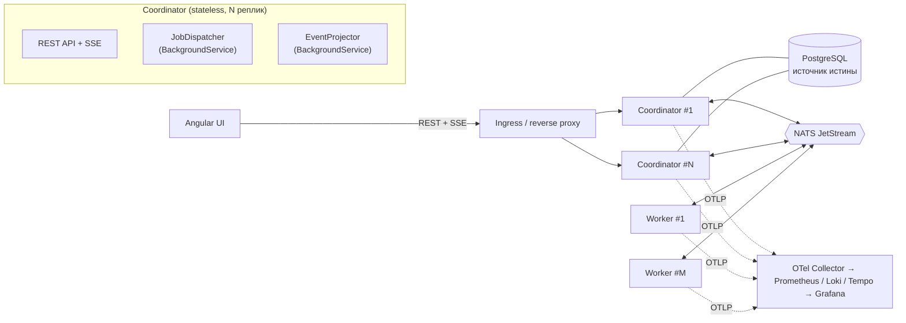
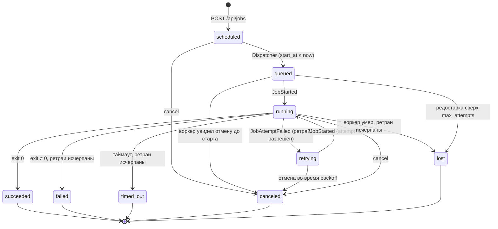
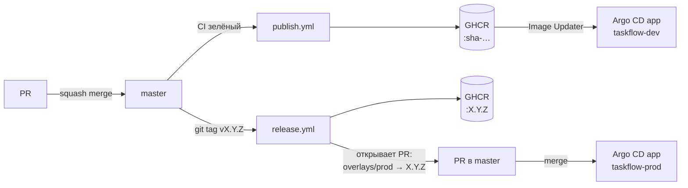
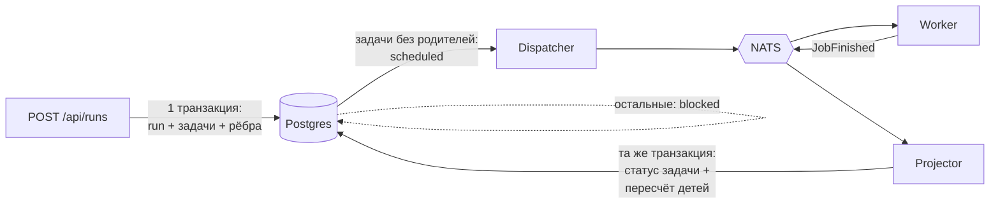

# TaskFlow — спецификация (v1.1.1)

> **Статус: утверждена, 2026-11-18** (v1.1 — процесс разработки: git и CI/CD, §10.5). Базовая версия для реализации MVP. Новые фичи и изменения — следующими версиями (v1.1, …), см. «История изменений» в конце.
> Цель проекта — изучить C#/.NET (переход с C++) на реалистичной распределённой системе, местами «как в проде».

---

## 1. Что строим

TaskFlow — распределённый планировщик shell-задач. Пользователь в web-UI создаёт **job**: bash-команду, время старта (`start_at`), таймаут и политику ретраев. Система в нужный момент отдаёт job одному из воркеров. Воркер выполняет команду в изолированном процессе, стримит логи и сообщает результат. Координаторов и воркеров может быть сколько угодно, и любой из них может упасть в любой момент.

### 1.1. Входит в MVP

| # | Возможность |
|---|---|
| F1 | Создать job: `command`, `start_at` (по умолчанию «сейчас»), `timeout`, `retry` |
| F2 | Отложенный запуск по `start_at` (точность ≈ 1 с) |
| F3 | Выполнение `bash -c` в отдельном процессе внутри пода воркера, с таймаутом |
| F4 | Политика ретраев **на уровне job** (`max_attempts`, `retry_on`, `backoff`) |
| F5 | Если воркер умер посреди job-а, это обнаруживается автоматически, и job ретраится или помечается `lost` |
| F6 | Отмена job-а (cancel), и ожидающего, и уже запущенного |
| F7 | Live-tail stdout/stderr в UI (SSE); логи живут в NATS 24 ч |
| F8 | Список job-ов, карточка job-а с историей попыток, список живых воркеров |
| F9 | N координаторов + M воркеров одновременно, без единой точки отказа в коде |
| F10 | Метрики, трейсы и логи сервисов через OpenTelemetry → Grafana LGTM |
| F11 | Идемпотентное создание: повторный `POST` с тем же `Idempotency-Key` не создаёт второй job |

### 1.2. Не входит в MVP (backlog)

**DAG задач — главное направление после MVP (§15)** · скачивание ресурсов перед стартом · лимиты CPU/памяти (cgroups v2) · несколько job-ов одновременно на воркере · cron/повторяющиеся job-ы · приоритеты · аутентификация (Keycloak/OIDC) · архив логов в MinIO/S3 · автоскейлинг воркеров (KEDA) · DLQ-обработчик.

### 1.3. Нефункциональные требования

- **Семантика:**
  - *создание job-а* — **exactly-once**: повтор `POST` с тем же `Idempotency-Key` возвращает уже созданный job (§5, §7);
  - *выполнение команды* — **at-most-once по умолчанию** (`max_attempts = 1`): если воркер пропал, job помечается `lost` и повторно не запускается;
  - **at-least-once — по желанию** для конкретного job-а (`max_attempts > 1`, `retry_on: lost`): тогда при сетевом разделении команда может выполниться дважды (§6.4).

  Вместе это значит: при настройках по умолчанию одно нажатие «Создать» (с любым числом сетевых повторов) приводит максимум к одному запуску команды.
- Ни один компонент не хранит состояние, которое нельзя потерять: координаторы stateless, воркеры держат только текущий job.
- Любой процесс можно убить `kill -9` в любой момент, и система сойдётся к корректному состоянию.
- ⚠️ **Безопасность.** TaskFlow — по сути «RCE как сервис». Пока нет auth, его **нельзя** выставлять наружу: только localhost или k3d.

---

## 2. Архитектура

### 2.1. Компоненты



| Компонент | Ответственность | Масштабирование |
|---|---|---|
| **Coordinator** | REST API, SSE; **Dispatcher** публикует job-ы, у которых наступил `start_at`; **Projector** применяет события воркеров к Postgres | N реплик; dispatcher безопасен благодаря `SKIP LOCKED`, projector — через общий durable consumer |
| **Worker** | Тянет job-ы из JetStream, выполняет процесс, стримит логи, публикует события, шлёт heartbeat | M реплик; не знает о координаторах и не ходит в БД |
| **Migrator** | DbUp-миграции **и** идемпотентное создание NATS stream-ов/consumer-ов/KV | Одноразовый Job перед деплоем |
| **PostgreSQL** | Источник истины по job-ам и попыткам | 1 инстанс (в k8s — CloudNativePG, post-MVP) |
| **NATS JetStream** | Очередь job-ов, шина событий, логи, KV (воркеры, отмены) | 1 узел в dev, кластер из 3 в k3d |
| **Angular UI** | Формы, списки, live-логи | Статика за nginx |

### 2.2. Ключевые решения (кратко; подробно в §11 ADR)

1. **Брокер — NATS JetStream для всего**: work-queue для job-ов, stream для событий, stream для логов, KV для реестра воркеров и отмен.
2. **gRPC-стрим Worker↔Coordinator удаляется.** Воркер общается только с NATS, координаторы становятся полностью stateless.
3. **Postgres — источник истины, а статусы обновляются через события.** Воркер публикует `JobStarted`/`JobFinished`, Projector идемпотентно применяет их к БД (паттерн inbox).
4. **`start_at` обрабатывает Dispatcher в координаторе** (поллинг Postgres + `SKIP LOCKED` + дедупликация JetStream), а не нативный scheduler NATS 2.12 — так проще отмена и наглядна вся очередь в SQL.
5. **Обнаружение смерти воркера — через AckWait JetStream.** Воркер продлевает «аренду» сообщения (`AckProgress`) каждые 10 с; если он умер, сообщение уходит другому воркеру.

---

## 3. Жизненный цикл job-а

### 3.1. Машина состояний



Терминальные статусы: `succeeded`, `failed`, `timed_out`, `canceled`, `lost`. Переходы описываются в одном месте — `JobStateMachine` (switch expression по паре `(status, event)`); Projector отбрасывает недопустимые переходы.

### 3.2. Счастливый путь

```mermaid
sequenceDiagram
    autonumber
    participant UI as Angular UI
    participant API as Coordinator API
    participant PG as PostgreSQL
    participant D as Dispatcher (любой координатор)
    participant JS as NATS JetStream
    participant W as Worker
    participant P as Projector (любой координатор)

    UI->>API: POST /api/jobs (Idempotency-Key)
    API->>PG: INSERT status=scheduled ON CONFLICT (idempotency_key) DO NOTHING
    API-->>UI: 201 Created (повтор того же запроса → 200 с тем же job-ом)
    loop каждую ~1 с (+ LISTEN/NOTIFY)
        D->>PG: BEGIN; SELECT … start_at ≤ now() FOR UPDATE SKIP LOCKED
        D->>JS: publish taskflow.jobs.dispatch (Nats-Msg-Id = jobId)
        JS-->>D: PubAck
        D->>PG: UPDATE status=queued; COMMIT
    end
    W->>JS: Fetch(1) из consumer job-workers
    W->>JS: publish JobStarted(attempt = NumDelivered)
    W->>W: bash -c command (таймаут, логи → taskflow.logs.<jobId>)
    loop каждые 10 с
        W->>JS: AckProgress (+WPI)
    end
    W->>JS: publish JobFinished(succeeded, exit 0)
    W->>JS: Ack job-сообщения (только после PubAck события)
    JS->>P: JobStarted / JobFinished
    P->>PG: UPDATE jobs + job_attempts + inbox (одна транзакция)
    P->>JS: core publish taskflow.ui.job-updated.<jobId>
    JS-->>API: (все координаторы подписаны)
    API-->>UI: SSE: job updated → UI перезапрашивает job
```

### 3.3. Сбои

| Сценарий | Что происходит |
|---|---|
| Клиент не дождался ответа на `POST` и повторил его | Тот же `Idempotency-Key` → `ON CONFLICT` → возвращается существующий job (`200`), второй не создаётся |
| Координатор упал после publish, но до COMMIT | Строка остаётся `scheduled` → следующий dispatcher публикует снова → JetStream отбрасывает дубль по `Nats-Msg-Id` (окно дедупликации 5 мин) |
| Воркер убит `kill -9` во время job-а | `AckProgress` прекращаются → через `AckWait` (30 с) сообщение уходит другому воркеру с `NumDelivered+1`. Тот сверяет его с `max_attempts`: если `retry_on` содержит `lost` и попытки остались, то выполняет, иначе делает `Term` и публикует `JobFinished(lost)` |
| Команда завершилась с exit ≠ 0 | Если `retry_on` содержит `failed` и попытки остались → `JobAttemptFailed` + `Nak(delay = backoff)`. Иначе → `JobFinished(failed)` + `Ack` |
| Таймаут | SIGTERM → 10 с grace → SIGKILL всего дерева процессов; дальше как `failed`, но с флагом `timed_out` |
| Projector упал посреди транзакции | Событие не Ack-нуто → редоставка → inbox-таблица отсекает уже применённое |
| Воркер получает SIGTERM (rolling update) | Перестаёт брать новые job-ы; ждёт текущий до `ShutdownJobWait` (25 с), затем убивает его и делает `Nak` — job уйдёт другому воркеру |
| Все воркеры мертвы | Job-ы копятся в stream; в UI они `queued`/`running`. Известное ограничение MVP; post-MVP — watchdog в координаторе |

---

## 4. NATS-топология

### 4.1. Streams

| Stream | Subjects | Retention | Лимиты | Назначение |
|---|---|---|---|---|
| `TASKFLOW_JOBS` | `taskflow.jobs.dispatch` | **WorkQueue** | duplicate window 5m | Очередь job-ов |
| `TASKFLOW_EVENTS` | `taskflow.events.job.>` | Limits | MaxAge 7d | События воркеров → Projector |
| `TASKFLOW_LOGS` | `taskflow.logs.>` | Limits | MaxAge 24h, MaxBytes 1 GiB, DiscardOld | stdout/stderr job-ов |

### 4.2. Consumers

| Consumer | Stream | Тип | Настройки |
|---|---|---|---|
| `job-workers` | `TASKFLOW_JOBS` | durable pull | AckPolicy=Explicit, **AckWait=30s**, MaxDeliver=20 (глобальный потолок; реальный лимит — `max_attempts` job-а), MaxAckPending=1000 |
| `projector` | `TASKFLOW_EVENTS` | durable pull, общий для всех координаторов | AckWait=30s, MaxDeliver=∞ (+ алерт на редоставки) |
| (эфемерные) | `TASKFLOW_LOGS` | ordered consumer, filter `taskflow.logs.<jobId>`, DeliverAll | Создаётся на каждое SSE-подключение к логам — сразу отдаёт и историю, и хвост |

### 4.3. KV и core-subjects

| Имя | Тип | Назначение |
|---|---|---|
| `taskflow-workers` | KV, TTL 15s | Воркер пишет `{id, host, startedAt, runningJobId}` каждые 5 с; запись истекает → воркер считается мёртвым |
| `taskflow-cancel` | KV, TTL 24h | Ключ = jobId. Пишет API при cancel; воркеры делают `Watch` (и проверяют ключ перед стартом job-а) |
| `taskflow.ui.job-updated.<jobId>` | core pub/sub | Projector сигналит после COMMIT; каждый координатор пересылает своим SSE-клиентам |

Все streams, consumers и KV создаёт **Migrator** (идемпотентно, `CreateOrUpdate…`); сервисы при старте только проверяют, что они есть.

### 4.4. Сообщения (JSON + System.Text.Json source generation)

Все контракты лежат в `TaskFlow.Contracts`. W3C `traceparent` передаётся в NATS-заголовках.

```csharp
// taskflow.jobs.dispatch     Nats-Msg-Id: {jobId}
public sealed record JobDispatch(
    Guid JobId, string Command, int TimeoutSeconds,
    RetryPolicy Retry, DateTimeOffset EnqueuedAt);

public sealed record RetryPolicy(
    int MaxAttempts,             // 1..10, по умолчанию 1
    RetryOn RetryOn,             // [Flags] None | Failed | TimedOut | Lost; по умолчанию Lost
    int BackoffSeconds);         // 0..3600

// taskflow.events.job.{started|attempt_failed|finished}
// Nats-Msg-Id: {jobId}.{attempt}.{type}
public abstract record JobEvent(Guid EventId, Guid JobId, int Attempt,
                                string WorkerId, DateTimeOffset OccurredAt);
public sealed record JobStarted(...) : JobEvent(...);
public sealed record JobAttemptFailed(..., AttemptResult Result, int? ExitCode,
                                      string? Error, TimeSpan RetryIn) : JobEvent(...);
public sealed record JobFinished(..., FinalResult Result, int? ExitCode,
                                 string? Error) : JobEvent(...);

// taskflow.logs.{jobId}   (батч: до 64 строк или 200 мс)
public sealed record LogBatch(Guid JobId, int Attempt, long FirstSeq,
                              IReadOnlyList<LogLine> Lines);
public sealed record LogLine(LogStream Stream, DateTimeOffset Ts, string Text); // Text ≤ 8 KiB
```

`attempt` = `NumDelivered` из метаданных JetStream-сообщения. Это и есть **fencing token**: Projector не даёт событию попытки *n* перетереть состояние попытки *n+1*.

---

## 5. Данные (PostgreSQL)

Текущая схема (`001`–`003`) заменяется. Данных пока нет, поэтому можно пересоздать схему одним скриптом `004_reshape_jobs.sql` (или обнулить журнал DbUp — на твой выбор).

```sql
create type job_status as enum (
  'scheduled', 'queued', 'running', 'retrying',
  'succeeded', 'failed', 'timed_out', 'canceled', 'lost');

create table jobs (
  id                   uuid primary key,          -- UUIDv7: Guid.CreateVersion7()
  idempotency_key      text        null,          -- заголовок Idempotency-Key, ≤ 128 символов
  request_hash         bytea       null,          -- SHA-256 отпечаток запроса (см. ниже)
  command              text        not null,
  start_at             timestamptz not null,
  timeout_seconds      integer     not null check (timeout_seconds between 1 and 86400),
  max_attempts         smallint    not null default 1 check (max_attempts between 1 and 10),
  retry_on             smallint    not null default 4,   -- битовая маска RetryOn
  backoff_seconds      integer     not null default 0,

  status               job_status  not null,
  current_attempt      smallint    not null default 0,
  worker_id            text        null,
  exit_code            integer     null,
  error                text        null,

  created_at           timestamptz not null,
  queued_at            timestamptz null,
  started_at           timestamptz null,
  finished_at          timestamptz null,
  cancel_requested_at  timestamptz null,
  updated_at           timestamptz not null
);

create index ix_jobs_due    on jobs (start_at) where status = 'scheduled';
create unique index ux_jobs_idempotency on jobs (idempotency_key) where idempotency_key is not null;
create index ix_jobs_status on jobs (status, id desc);

create table job_attempts (
  job_id       uuid     not null references jobs(id),
  attempt      smallint not null,
  worker_id    text     not null,
  started_at   timestamptz not null,
  finished_at  timestamptz null,
  result       text     null,         -- succeeded/failed/timed_out/canceled/lost
  exit_code    integer  null,
  primary key (job_id, attempt)
);

-- inbox: идемпотентность Projector-а
create table processed_messages (
  msg_id        text primary key,     -- Nats-Msg-Id
  processed_at  timestamptz not null
);
```

**Создание с Idempotency-Key.** Ключ генерирует клиент (UI — `crypto.randomUUID()` один раз на отправку формы; `curl`/скрипты — свой UUID). Генерировать его на прокси/ingress бессмысленно: повтор — это новый HTTP-запрос, прокси выдал бы ему новый ключ. Ключ необязателен: без него job создаётся как обычно, но без защиты от дублей.

Два шага: обычный путь (новый ключ) — один запрос, повтор — два.

```sql
-- шаг 1
insert into jobs (id, idempotency_key, request_hash, command, start_at, …, status, created_at, updated_at)
values (@Id, @Key, @Hash, @Command, @StartAt, …, 'scheduled', now(), now())
on conflict (idempotency_key) where idempotency_key is not null do nothing
returning id;

-- шаг 2, только если шаг 1 вернул 0 строк
select id, request_hash from jobs where idempotency_key = @Key;
```

```csharp
var id = await conn.ExecuteScalarAsync<Guid?>(InsertSql, args);
if (id is not null)
    return TypedResults.Created($"/api/jobs/{id}", …);              // 201

var existing = await conn.QuerySingleAsync<(Guid Id, byte[] Hash)>(SelectByKeySql, new { Key });
return existing.Hash.AsSpan().SequenceEqual(hash)
    ? Replayed(existing.Id)                                          // 200 + Idempotent-Replayed: true
    : UnprocessableEntity();                                         // 422: тот же ключ, другое тело
```

Почему не в один запрос:
- `RETURNING` при `ON CONFLICT DO NOTHING` возвращает **0 строк**, а не существующую запись, — получить её `request_hash` так нельзя.
- Трюк `ON CONFLICT DO UPDATE SET idempotency_key = excluded.idempotency_key RETURNING …` работает, но каждый повтор физически перезаписывает строку (новая версия MVCC, WAL, блокировка — и ожидание, если строку держит Dispatcher).
- CTE «вставь или прочитай» в одном операторе ловит гонку: в `READ COMMITTED` снимок берётся на весь оператор, и строку, закоммиченную конкурентом, пока мы ждали на уникальном индексе, `select` в том же операторе не увидит. Отдельный второй запрос получает свежий снимок.

**Отпечаток запроса (`request_hash`).** SHA-256 от канонической формы **разобранного** запроса: DTO → JSON через source-gen контекст (фиксированный порядок полей) → `SHA256.HashData`. Сырые байты не годятся: другой порядок ключей или пробелы — это тот же запрос. ⚠ Хэшируем запрос **как пришёл, до подстановки значений по умолчанию**: если `startAt` не передан, хэшируется `null`, а не `now()` — иначе у повтора будет другое `now()` и ложный `422`.

**Конкурентные повторы.** Два запроса с одним ключом одновременно: второй ждёт на уникальном индексе, пока первый закоммитит, затем идёт по ветке «повтор» → `200`. Состояния «запрос ещё обрабатывается» нет (операция — один `INSERT`), поэтому `409 Conflict` из черновика IETF нам не нужен.

**Хранение ключей.** В MVP — вместе с job-ом, бессрочно. Когда появится auth, уникальный индекс станет `(owner_id, idempotency_key)`: иначе пользователь, угадавший чужой ключ, получит в ответ чужой job.

**Dispatcher (один тик).** Это одна транзакция из двух SQL-запросов, а между ними — C#-код публикации. Блокировки строк, взятые `FOR UPDATE`, держатся до `COMMIT`.

```
BEGIN
  SELECT … FOR UPDATE SKIP LOCKED LIMIT 50   ← строки заблокированы до COMMIT
  (C#: publish в NATS, ждём PubAck)          ← транзакция открыта
  UPDATE … SET status = 'queued'             ← только для опубликованных
COMMIT
```

```sql
-- запрос 1
select id, command, timeout_seconds, max_attempts, retry_on, backoff_seconds
from jobs
where status = 'scheduled' and start_at <= now()
order by start_at
for update skip locked
limit 50;

-- запрос 2
update jobs set status = 'queued', queued_at = now(), updated_at = now()
where id = any(@Ids);
```

```csharp
await using var conn = await dispatcherDataSource.OpenConnectionAsync(ct);
await using var tx = await conn.BeginTransactionAsync(ct);

var due = (await conn.QueryAsync<DueJob>(SelectDueSql, transaction: tx)).AsList();

using var publishCts = CancellationTokenSource.CreateLinkedTokenSource(ct);
publishCts.CancelAfter(options.PublishBatchTimeout);          // 5 с на всю пачку

var published = new List<Guid>(due.Count);
foreach (var job in due)
{
    try
    {
        var ack = await js.PublishAsync(
            Subjects.Dispatch, ToMessage(job),
            opts: new NatsJSPubOpts { MsgId = job.Id.ToString() },
            cancellationToken: publishCts.Token);
        ack.EnsureSuccess();
        published.Add(job.Id);
    }
    catch (Exception ex) when (!ct.IsCancellationRequested)
    {
        // NATS недоступен или вышел таймаут пачки → остальные уйдут на следующем тике
        logger.LogWarning(ex, "Publish failed for {JobId}", job.Id);
        break;
    }
}

if (published.Count > 0)
    await conn.ExecuteAsync(MarkQueuedSql, new { Ids = published.ToArray() }, tx);

await tx.CommitAsync(ct);
```

Почему так:
- **`LIMIT 50` + `SKIP LOCKED`** делит работу между координаторами: каждый берёт свою пачку, никто никого не ждёт, ни одна строка не достаётся двоим. Без `LIMIT` один координатор после простоя захватил бы тысячи строк надолго; при `LIMIT 1` пришлось бы делать отдельную транзакцию на каждый job.
- **Блокировка строчная**: чтение (`GET /api/jobs`) не блокируется вообще (MVCC); писатели в эти строки (например, cancel) ждут не дольше, чем длится транзакция.
- **Publish упал на N-м job-е** → в `queued` переходят первые N−1, остальные остаются `scheduled` до следующего тика.
- **Процесс упал до `COMMIT`** → откат, строки снова `scheduled`, следующий тик опубликует их повторно, и NATS отбросит дубли по `MsgId`.

**Транзакция открыта во время сетевого вызова — ограничиваем таймаутами:**

| Защита | Значение | Как |
|---|---|---|
| Публикация всей пачки | 5 с | Связанный `CancellationTokenSource` + `CancelAfter`; при срабатывании прерываем цикл и коммитим то, что успело опубликоваться |
| Страховка в Postgres | 30 с | `idle_in_transaction_session_timeout` только для соединений Dispatcher-а: если процесс завис целиком (GC, `SIGSTOP`), Postgres сам оборвёт сессию и снимет блокировки |

```csharp
// отдельный источник данных только для Dispatcher-а
var dispatcherDataSource = new NpgsqlDataSourceBuilder(connString)
{
    ConnectionStringBuilder = { Options = "-c idle_in_transaction_session_timeout=30000" }
}.Build();
```

Таймаут Postgres намеренно больше таймаута публикации: в нормальном случае транзакцию закрывает C#-код, Postgres вмешивается только как последняя страховка.

*Отклонённая альтернатива* — «застолбить, потом публиковать»: короткая транзакция переводит строки в `dispatching`, публикация идёт без транзакции, затем `queued`. Транзакция не держится во время сети, но нужен лишний статус и «уборщик» для строк, зависших в `dispatching` после падения координатора. Для MVP это избыточно.

Чтобы задержка была меньше секунды, триггер на `INSERT` делает `pg_notify('jobs_due', '')`, если `start_at <= now()`; dispatcher слушает канал через `NpgsqlConnection.WaitAsync` и просыпается сразу.

**Cancel:**
- `scheduled` → в транзакции `set local lock_timeout = '5s'`, затем `update … set status='canceled' where id=@id and status='scheduled'` (атомарно). Если строку держит Dispatcher, запрос подождёт; если дольше 5 с (Dispatcher завис) — API вернёт `503`, а не будет висеть. Обновилось 0 строк → job уже ушёл в `queued`, идём по второму пункту.
- Остальные нетерминальные статусы → `cancel_requested_at = now()` + `kv.Put("taskflow-cancel", jobId)`. Финальный статус `canceled` придёт событием от воркера.

---

## 6. Worker

### 6.1. Внутреннее устройство

```
WorkerHostedService
 ├─ JobConsumerLoop      Fetch(1) → ExecuteAsync → Ack/Nak/Term
 ├─ HeartbeatLoop        KV put taskflow-workers/<id> каждые 5 с
 ├─ CancelWatcher        KV Watch taskflow-cancel → CancellationTokenSource текущего job-а
 └─ JobExecution
     ├─ ProcessRunner    /bin/bash -c, свой workdir, своё дерево процессов
     ├─ LogPump          stdout/stderr → Channel<LogLine> → батчи → JetStream
     ├─ LeaseKeeper      AckProgress каждые 10 с
     └─ Signals          P/Invoke kill(pid, SIGTERM) → grace → Process.Kill(entireProcessTree: true)
```

`WorkerId` = имя пода (`HOSTNAME`), а **не** константа из env (сейчас в compose стоит `TASKFLOW_WORKER_ID: 123`, что ломает `--scale`).

### 6.2. Алгоритм обработки сообщения

```
msg = Fetch(1)
attempt = msg.Metadata.NumDelivered
if kv.Exists(taskflow-cancel/jobId)        → publish Finished(canceled); Term
if attempt > job.MaxAttempts               → publish Finished(lost);     Term
publish Started(attempt)
result = RunProcess(job, timeout, cancelToken)   // LeaseKeeper и LogPump работают параллельно
flush logs
switch result:
  Succeeded                                → publish Finished(succeeded); Ack
  Canceled                                 → publish Finished(canceled);  Ack
  Failed/TimedOut and retryable and attempt < max
                                           → publish AttemptFailed(retryIn); Nak(delay = backoff)
  else                                     → publish Finished(failed|timed_out); Ack
```

Инвариант: **Ack/Nak/Term job-сообщения делаем только после PubAck события.** Иначе можно потерять результат.

### 6.3. Изоляция процесса (MVP)

- Отдельный workdir `/var/lib/taskflow/jobs/<jobId>/<attempt>` (emptyDir в k8s), удаляется после завершения.
- Чистое окружение: только `PATH`, `HOME=workdir`, `TASKFLOW_JOB_ID`, `TASKFLOW_ATTEMPT`.
- Контейнер воркера запускается non-root, rootfs read-only, кроме workdir и `/tmp`.
- Убиваем всё дерево процессов (`entireProcessTree`), чтобы `bash -c "sleep 999 &"` не оставлял сирот.
- Post-MVP: cgroup v2 на каждый job (`memory.max`, `cpu.max`) или `nsjail`/`bubblewrap`; скачивание ресурсов в workdir с проверкой checksum.

### 6.4. At-most-once и at-least-once: когда возможен двойной запуск

**At-most-once (по умолчанию, `max_attempts = 1`).** Если воркер перестал присылать `AckProgress`, через 30 с JetStream отдаст сообщение другому воркеру с `NumDelivered = 2`. Тот видит `attempt > max_attempts`, делает `Term` и публикует `JobFinished(lost)`, **не запуская команду** (§6.2). Двойного выполнения нет никогда; цена — job может закончиться `lost`, даже если «зависший» воркер на самом деле доработал до конца (его поздний `JobFinished` отбрасывается: статус уже терминальный).

**At-least-once (`max_attempts > 1`, `retry_on` содержит `lost`).** Если воркер «завис», но жив (GC-пауза, сеть), и не успел прислать `AckProgress` за 30 с, JetStream отдаст job второму воркеру, и оба выполнят команду. Защита:
- fencing по `attempt`: Projector применяет только события актуальной попытки;
- `AckProgress` с запасом (10 с при AckWait 30 с);
- в UI и доке прямо сказано: в этом режиме **команды должны быть идемпотентными** (ключ для внешних систем — `TASKFLOW_JOB_ID`).

`Idempotency-Key` (§5) защищает от дублей на входе (повторный `POST`), а режим выше — от дублей при выполнении. Вместе с настройками по умолчанию они дают «одно действие пользователя → максимум один запуск».

---

## 7. Coordinator API

| Метод | Путь | Описание |
|---|---|---|
| POST | `/api/jobs` | Создать job (заголовок `Idempotency-Key` — необязательный) → см. таблицу ответов ниже |
| GET | `/api/jobs?status=&limit=50&after=<id>` | Список, keyset-пагинация по UUIDv7 |
| GET | `/api/jobs/{id}` | Job + попытки |
| POST | `/api/jobs/{id}/cancel` | `202 Accepted`; `409`, если job уже терминальный |
| GET | `/api/jobs/{id}/logs/stream` | SSE: история (до 24 ч) + live |
| GET | `/api/events/stream` | SSE: `job-updated {jobId, status}` |
| GET | `/api/workers` | Живые воркеры из KV |
| GET | `/healthz/live`, `/healthz/ready` | k8s-пробы (ready = есть Postgres и NATS) |
| GET | `/openapi/v1.json` | OpenAPI (встроенный `Microsoft.AspNetCore.OpenApi`) + Scalar UI в dev |

Пример запроса:

```json
POST /api/jobs
Idempotency-Key: 6f1c2a1e-8a52-4d3b-9a0e-2b7f0c9d4e11

{
  "command": "echo hello && sleep 5",
  "startAt": "2026-11-17T12:00:00Z",
  "timeoutSeconds": 60,
  "retry": { "maxAttempts": 3, "retryOn": ["lost", "failed"], "backoffSeconds": 10 }
}
```

Ответы `POST /api/jobs`:

| Ситуация | Ответ |
|---|---|
| Новый ключ (или ключа нет) | `201 Created` + `Location: /api/jobs/{id}`, в теле — job |
| Тот же ключ, тот же отпечаток | `200 OK` + `Idempotent-Replayed: true`, в теле — **текущее** состояние job-а (он мог уже стать `running`/`succeeded`). Клиент обрабатывает `200` и `201` одинаково |
| Тот же ключ, другой отпечаток | `422` ProblemDetails: «ключ уже использован для другого запроса» — ошибка клиента, молча возвращать чужой job нельзя |
| Ключ некорректен (пустой, > 128 символов, непечатные символы) | `400` |
| Тело невалидно | `400` ValidationProblem; в БД ничего не попало — можно исправить тело и повторить с тем же ключом |
| Postgres недоступен | `503`; ничего не сохранено — повтор с тем же ключом безопасен |

Порядок проверок: формат ключа → валидация тела → `INSERT` → при конфликте сравнение отпечатков.

Ошибки валидации возвращаются как `ValidationProblem` (RFC 9457), как и сейчас. Для SSE — встроенный `TypedResults.ServerSentEvents` из ASP.NET Core 10 + `IAsyncEnumerable`.

---

## 8. Angular UI

- Актуальный Angular: standalone-компоненты, signals, Angular Material.
- TS-клиент генерируется из OpenAPI (`ng-openapi-gen` или `orval`), руками DTO не пишем.
- Страницы:
  1. **Jobs** — таблица со статусами, фильтр, live-обновление через `/api/events/stream`.
  2. **New job** — форма (command, start_at, timeout, retry; переключатель «at-most-once / at-least-once» управляет `maxAttempts`/`retryOn`). `Idempotency-Key` создаётся при отправке формы и переиспользуется при ретраях `HttpClient` и повторном клике, пока ждём ответа; после успеха сбрасывается.
  3. **Job details** — поля, попытки, кнопка Cancel, терминал с live-логами (`EventSource`, автоскролл, stdout/stderr разными цветами).
  4. **Workers** — список из KV.
- Dev: `ng serve` с `proxy.conf.json` → `http://localhost:8080`. Prod: nginx-образ, Ingress маршрутизирует `/api` → coordinator, `/` → ui.

---

## 9. Observability

Все сервисы подключают общий проект `TaskFlow.ServiceDefaults` (OTel + health checks, по образцу Aspire).

**Трейсы:** ASP.NET Core, HttpClient, Npgsql (`Npgsql.OpenTelemetry`) + собственный `ActivitySource("TaskFlow")`. `traceparent` пробрасывается через заголовки NATS, поэтому один трейс тянется `POST /api/jobs → dispatch → worker execute → projector`. Это главный «вау-момент» в Tempo.

**Метрики** (`Meter("TaskFlow")`):

| Метрика | Тип | Где |
|---|---|---|
| `taskflow.jobs.submitted` | counter | API |
| `taskflow.jobs.dispatched` | counter | Dispatcher |
| `taskflow.jobs.finished{result}` | counter | Projector |
| `taskflow.job.schedule_lag` (start_at → started) | histogram, s | Projector |
| `taskflow.jobs.idempotent_replays{result=replayed|mismatch}` | counter | API |
| `taskflow.job.duration` | histogram, s | Worker |
| `taskflow.job.attempts{result}` | counter | Worker |
| `taskflow.worker.busy` | up-down counter | Worker |
| `taskflow.projector.redeliveries` | counter | Projector |

Плюс встроенные метрики .NET runtime и Kestrel. NATS-сервер — `prometheus-nats-exporter` (post-MVP).

**Логи сервисов:** `ILogger` → OTel logs → Loki, структурированные, со scope `{JobId, Attempt, WorkerId}`. Логи *job-ов* (stdout команды) идут отдельно через NATS и в Loki не попадают.

**Стек:** локально — один контейнер `grafana/otel-lgtm` (Collector + Prometheus + Loki + Tempo + Grafana). В k3d — тот же образ в MVP; дашборд `TaskFlow Overview` хранится как JSON в `deploy/grafana/`.

---

## 10. Разработка и деплой

### 10.1. Dev loop (решение: compose для разработки, k3d — для «как в проде»)

| Режим | Команда | Когда |
|---|---|---|
| **Инфра в compose, сервисы из Rider** | `docker compose up postgres nats lgtm migrator` | Каждый день: отладка, брейкпоинты, hot reload |
| **Всё в compose** | `docker compose --profile full up --scale worker=3 --scale coordinator=2` (+ Caddy/nginx перед координаторами) | Быстрая проверка нескольких инстансов |
| **k3d** | `make k3d-up && make deploy` | Rolling update, chaos-тесты, Ingress, NATS-кластер |

Docker Swarm не используем: k8s — более ценный навык, а для «быстро поднять несколько копий» хватит compose `--scale`. Tilt добавим позже, если цикл «собрал образ → `k3d image import` → `kubectl rollout restart`» начнёт раздражать.

### 10.2. Kubernetes (k3d)

```
deploy/k8s/
  base/                 # kustomize
    coordinator/        Deployment (replicas 2), Service, ConfigMap, probes
    worker/             Deployment (replicas 3), terminationGracePeriodSeconds: 60, emptyDir
    migrator/           Job
    ui/                 Deployment (nginx), Service
    ingress.yaml        Traefik (встроен в k3s)
    lgtm/               otel-lgtm Deployment
  overlays/
    dev/                namespace taskflow-dev, образы из master (обновляет Argo CD Image Updater)
    prod/               namespace taskflow-prod, образы с тегом релиза (меняются только через PR)
  argocd/               Application-ы taskflow-dev и taskflow-prod, настройки Image Updater
  helm-values/
    nats.yaml           официальный chart nats-io/k8s: JetStream, cluster 3
    cnpg-cluster.yaml   (post-MVP) CloudNativePG
```

- Свои сервисы описываем через **kustomize** (встроен в `kubectl`), сторонние ставим **Helm**-чартами.
- Postgres в MVP — простой StatefulSet; позже CloudNativePG-оператор.
- Образы: в «как в проде»-режиме — из GitHub Container Registry, выкатку делает Argo CD (§10.5). Для быстрой локальной проверки без CI — `k3d image import`.
- Порядок: `helm install nats` → `kubectl apply job/migrator` → `kubectl wait --for=condition=complete` → остальное.
- Post-MVP: **KEDA** со скейлером NATS JetStream масштабирует воркеров по числу pending-сообщений в `job-workers`.

### 10.3. Структура репозитория

```
TaskFlow/
  global.json  Directory.Build.props  Directory.Packages.props   # central package mgmt
  TaskFlow.slnx
  src/
    TaskFlow.Coordinator/   Api/ Dispatching/ Projection/ Jobs/ Persistence/ Messaging/
    TaskFlow.Worker/        Messaging/ Execution/
    TaskFlow.Contracts/     сообщения, имена subjects/streams, JsonSerializerContext
    TaskFlow.ServiceDefaults/
    TaskFlow.Migrator/      Scripts/  NatsProvisioning.cs
  ui/taskflow-ui/
  tests/
    TaskFlow.UnitTests/           xUnit, FakeTimeProvider
    TaskFlow.IntegrationTests/    Testcontainers (PostgreSql, Nats)
  deploy/  compose/  k8s/  grafana/
  .github/  workflows/ (ci.yml, publish.yml, release.yml)  pull_request_template.md
  docs/  spec.md  git-workflow.md  adr/
```

`Directory.Build.props`: `Nullable=enable`, `TreatWarningsAsErrors=true`, `AnalysisLevel=latest-recommended`. Central package management заодно уберёт текущий рассинхрон версий `Grpc.AspNetCore` (2.64 в Worker против 2.85 в Coordinator).

### 10.4. Тесты

- **Unit:** `JobStateMachine`, правила ретраев, парсинг/батчинг логов, валидация API. Время подменяем через `FakeTimeProvider` (`TimeProvider` уже внедрён — хорошо).
- **Integration (Testcontainers):** Dispatcher с двумя конкурентными инстансами (каждый job опубликован ровно один раз); Projector при повторной доставке (идемпотентность); воркер на реальном NATS: timeout, cancel, `Nak` с backoff.
- **E2E/chaos (в k3d, вручную или скриптом):** см. §12.

### 10.5. Процесс разработки: git и CI/CD

**Git — trunk-based** (подробности в `docs/git-workflow.md`):
- одна долгоживущая ветка `master`, всегда зелёная и готовая к выкатке; прямой push запрещён;
- короткоживущие ветки `<тип>/<issue>-<описание>`, PR = одно связное изменение (`Closes #N` или `Part of #N`);
- squash merge, заголовок PR в формате Conventional Commits; правки спеки — отдельными PR;
- контуры задаются окружениями и тегами, а не ветками: **dev** = последний `master`, **prod** = тег `vX.Y.Z`.

**CI** — GitHub Actions, `ci.yml`, на каждый PR и push в `master`:

| Шаг | Что проверяет |
|---|---|
| restore (с кешем NuGet) | зависимости |
| build | компиляция, предупреждения = ошибки |
| `dotnet format --verify-no-changes` | стиль |
| unit + integration тесты (Testcontainers) | поведение; Docker на `ubuntu-latest` есть |
| `docker build` без публикации | Dockerfile-ы не сломаны |
| (с M4) Angular: lint, test, build | UI |

Проверки CI — обязательные для merge в `master` (ruleset). Один прогон — не дольше ~10 минут.

**CD, публикация образов** — `publish.yml`, в GitHub Container Registry (`ghcr.io/<owner>/taskflow-<сервис>`):

| Событие | Теги образа |
|---|---|
| merge в `master` | `:master`, `:sha-<короткий sha>` |
| git-тег `vX.Y.Z` | `:X.Y.Z`, `:X.Y` |

**CD, выкатка — GitOps через Argo CD** в k3d. Кластер сам тянет состояние из репозитория и реестра; GitHub до локального кластера доступа не имеет и не должен иметь.



- **dev** (`taskflow-dev`, `overlays/dev`): Argo CD Image Updater следит за `:sha-*` в GHCR и выкатывает новый образ после каждого merge, без коммитов в репозиторий.
- **prod** (`taskflow-prod`, `overlays/prod`): версия образов записана в git. Релиз: тег `vX.Y.Z` → `release.yml` публикует образы и открывает PR, меняющий тег в `overlays/prod` → merge этого PR → Argo CD синхронизирует prod. Откат — PR с предыдущей версией (или `git revert`).
- Миграции БД в k8s выполняются как Argo CD sync hook (Job `migrator` в фазе `PreSync`), чтобы схема и streams обновлялись до выкатки сервисов.
- Если репозиторий и пакеты GHCR приватные — нужен `imagePullSecret` и доступ Argo CD к репозиторию (deploy key только на чтение).

**Кто пишет:** workflow-ы и манифесты Argo CD пишет автор проекта (это часть обучения), Claude ревьюит.

---

## 11. ADR (архитектурные решения)

### ADR-1. Брокер: NATS JetStream
- **Рассматривали:** Kafka (нет ack на отдельное сообщение, долгий job блокирует партицию, воркеров не больше, чем партиций); RabbitMQ + Kafka (два брокера — много инфраструктуры); RabbitMQ для всего.
- **Решение:** NATS JetStream. Work-queue с per-message ack, `AckProgress`, `Nak(delay)`, `Term`, `MaxDeliver`; streams для логов с replay; встроенный KV. Один лёгкий бинарник, официальный .NET-клиент `NATS.Net`.
- **Цена:** экосистема в .NET меньше, чем у Kafka/RabbitMQ; меньше готовых примеров.

### ADR-2. Убрать gRPC Worker↔Coordinator
- **Проблема:** стрим привязывает воркера к конкретному координатору; отмену или назначение надо маршрутизировать к «правильному» инстансу; реестр живёт в памяти.
- **Решение:** весь обмен идёт через NATS. Код `WorkerControlService`, `WorkerRegistry`, `WorkerSession`, `CoordinatorConnection`, `TryAssignNextAsync` удаляется (наработки по `Channel<T>` переиспользуем в LogPump).
- **Можно вернуть позже:** gRPC для внутреннего admin/query API, если захочется практики.

### ADR-3. Статусы — через события и проекцию
- Воркер не ходит в БД, Projector — единственный писатель статусов после `queued`.
- Inbox (`processed_messages`) + fencing по `attempt` дают идемпотентность при at-least-once.
- **Цена:** eventual consistency — UI видит статус с задержкой ~десятки мс.

### ADR-4. `start_at` обрабатывает Dispatcher, а не NATS Message Scheduler
- NATS ≥ 2.12 умеет отложенную публикацию (`Nats-Schedule`, ADR-51 NATS), а 2.14 — ещё и cron.
- **Почему не сейчас:** отмену и перенос проще делать в SQL; очередь видна запросом; `FOR UPDATE SKIP LOCKED` + outbox-подобная публикация — ценный учебный паттерн.
- **Пересмотреть,** когда дойдём до cron: нативные расписания NATS 2.14 могут оказаться проще своего cron-движка.

### ADR-5. Сериализация: JSON (STJ source-gen), не Protobuf
- Сообщения читаются глазами через `nats sub` / `nats stream view`, это сильно упрощает отладку.
- Source generators дают AOT-friendly сериализацию без reflection — хорошая C#-практика.

### ADR-6. Доступ к данным: Dapper + DbUp
- Остаёмся на ручном SQL: полный контроль, `SKIP LOCKED` и `LISTEN/NOTIFY` выражаются естественно.

### ADR-7. `Idempotency-Key` в MVP; выполнение at-most-once по умолчанию
- **Цель:** одно действие пользователя → максимум один запуск команды, даже если HTTP-запрос повторился (таймаут, двойной клик, обрыв сети).
- **Решение:** клиент присылает `Idempotency-Key`; уникальный частичный индекс + `ON CONFLICT DO NOTHING` + отпечаток тела дают exactly-once *создание* job-а. Выполнение — at-most-once по умолчанию (`max_attempts = 1`); at-least-once включается для job-а явно.
- **Рассматривали:** ключ на прокси/ingress (не работает: прокси не знает, что два запроса — повтор одного); дедупликацию по содержимому «тот же `command` за N секунд» (ломает законный повторный запуск той же команды).
- **Не гарантируем:** exactly-once *выполнения* произвольной bash-команды — при потере связи с воркером «умер» неотличим от «завис», и приходится выбирать между риском дубля (at-least-once) и риском потери (at-most-once). Эффективный exactly-once достижим только если сама команда идемпотентна (может использовать `TASKFLOW_JOB_ID` как ключ во внешней системе).

### ADR-8. Git: trunk-based, а не Git Flow
- **Рассматривали:** Git Flow с долгоживущей `develop` и релизными PR в `master`.
- **Решение:** trunk-based: `master` + короткие ветки задач, squash merge, контуры dev/prod — окружениями и тегами.
- **Почему:** в одиночном проекте без параллельной поддержки нескольких версий Git Flow даёт в основном накладные расходы: двойные merge-и, расхождение `develop` и `master`, обратное вливание хотфиксов. Разделение dev/prod достигается окружениями.
- **Цена:** `master` обязан быть всегда зелёным — это обеспечивают обязательный CI и защита ветки.

### ADR-9. Выкатка: GitOps (Argo CD), а не push из CI
- **Рассматривали:** self-hosted GitHub runner на локальной машине с `kubectl apply`; Flux; ручной `make deploy`.
- **Решение:** Argo CD в k3d (+ Image Updater для dev), prod меняется только через PR в `overlays/prod`.
- **Почему:** кластеру не нужен входящий доступ из GitHub; состояние кластера = состояние git, видно в UI Argo CD, откат = revert. Self-hosted runner исполнял бы код из репозитория на личной машине. Flux — равноценная альтернатива без UI; Argo CD выбран за наглядность.
- **Цена:** ещё один компонент в кластере; для dev — Image Updater.

---

## 12. План работ и критерии готовности

| Веха | Содержание | Готово, когда… |
|---|---|---|
| **M0. Фундамент** | `src/` + CPM + `Directory.Build.props`; `ServiceDefaults`; compose: nats (`-js`), otel-lgtm; Migrator создаёт streams/KV; удалён gRPC; **CI** (GitHub Actions) и защита `master` | `docker compose up` поднимает всё, `nats stream ls` показывает 3 stream-а; PR не мержится без зелёного CI |
| **M1. Happy path** | Новая схема; `POST/GET /api/jobs`; Dispatcher; Worker выполняет `bash -c` с таймаутом; события; Projector; **публикация образов в GHCR** (`publish.yml`) | `echo hi` проходит `scheduled → queued → running → succeeded`; 10 параллельных `POST` с одним ключом → ровно один job (один `201`, остальные `200`); тот же ключ с другим телом → `422`; `sleep 60` с timeout 5 → `timed_out` за ≤ 16 с; merge в `master` публикует образы `:master` и `:sha-*` |
| **M2. Надёжность** | `AckProgress`; ретраи per-job; `lost`; inbox; `job_attempts`; graceful shutdown | `kill -9` воркера посреди job-а с `max_attempts=2` → job доделывает другой воркер за ≤ 45 с; с `max_attempts=1` → `lost` |
| **M3. Cancel + логи + воркеры** | KV cancel + Watch; LogPump; SSE логов и событий; `/api/workers` | Cancel запущенного job-а убивает процесс за ≤ 2 с; строки логов появляются в `curl -N` за < 1 с |
| **M4. Angular UI** | 4 страницы, сгенерированный клиент | Весь сценарий M1–M3 можно пройти мышкой |
| **M5. Observability** | Сквозной трейс через NATS; метрики из §9; дашборд | В Tempo один трейс от POST до Projector; на дашборде schedule lag p95 и throughput |
| **M6. k3d** | kustomize + Helm NATS (cluster 3); 2 координатора, 3 воркера; Ingress; **Argo CD** (dev + prod, Image Updater, `release.yml`) | Rolling update координаторов без потери job-ов; `kubectl delete pod` воркера → поведение как в M2; merge в `master` сам доезжает до `taskflow-dev`; тег `v0.6.0` → PR → merge → `taskflow-prod` |

**Backlog после MVP** (примерно по ценности): DAG задач (§15) → concurrency-слоты на воркере → скачивание ресурсов → cgroups-лимиты → архив логов в MinIO → KEDA → cron (NATS 2.14 schedules?) → приоритеты (отдельные consumers/subjects) → Keycloak → CloudNativePG → watchdog «все воркеры мертвы».

---

## 13. Ключевые таймауты (одна таблица, чтобы не искать)

| Параметр | Значение | Почему |
|---|---|---|
| Dispatcher poll | 1 с (+ NOTIFY) | Точность `start_at` |
| Dispatcher batch | 50 | Короткие транзакции |
| Таймаут публикации пачки (Dispatcher) | 5 с | Ограничивает, сколько транзакция с блокировками держится открытой |
| `idle_in_transaction_session_timeout` (соединения Dispatcher-а) | 30 с | Страховка на случай зависания процесса; > таймаута публикации |
| `lock_timeout` для cancel | 5 с | API не висит, если строку держит зависший Dispatcher |
| JetStream duplicate window | 5 мин | ≫ максимальный разрыв между publish и COMMIT |
| `AckWait` (`job-workers`) | 30 с | Время обнаружения смерти воркера |
| `AckProgress` | каждые 10 с | 3 шанса до истечения AckWait |
| Kill grace (SIGTERM → SIGKILL) | 10 с | |
| Worker heartbeat / KV TTL | 5 с / 15 с | |
| `ShutdownJobWait` / `terminationGracePeriodSeconds` | 25 с / 60 с | |
| Лог-батч | 64 строки или 200 мс | |
| Лимит строки / логов на попытку | 8 KiB / 10 MiB | Дальше маркер `[truncated]` |

---

## 14. Что попрактиковать в C# (для перехода с C++)

| Тема | Где в проекте | Аналог в C++ |
|---|---|---|
| `async`/`await`, `CancellationToken`, linked CTS | Везде; таймаут + cancel + shutdown в воркере | корутины C++20 / `std::stop_token` |
| `Channel<T>`, `IAsyncEnumerable<T>` | LogPump, SSE | lock-free очереди, генераторы |
| `BackgroundService`, DI, Options + `ValidateOnStart` | Dispatcher, Projector, Worker loops | ручной wiring |
| `record`, pattern matching, switch expressions | Контракты, `JobStateMachine` | `std::variant` + `std::visit` |
| `IDisposable`/`IAsyncDisposable`, `using` | Соединения NATS/Npgsql, процессы | RAII |
| P/Invoke (`[LibraryImport]`) | `kill(pid, SIGTERM)` | прямой вызов libc |
| `Span<T>`/`Memory<T>` | Разбор потока stdout на строки без лишних аллокаций | `std::span` |
| Source generators (STJ, `LibraryImport`) | Сериализация, interop | constexpr/шаблонная кодогенерация |
| `TimeProvider` / `FakeTimeProvider` | Тестируемость таймаутов | инъекция часов |
| `Activity` / `Meter` | Трейсы и метрики | — |

---

## 15. Post-MVP: DAG задач (то самое «Flow» в TaskFlow)

> Не входит в MVP. Раздел фиксирует направление, чтобы решения MVP его не блокировали.

### 15.1. Идея

**Run** — один запуск DAG-а: набор job-ов (задач) и рёбер «родитель → ребёнок». Задача стартует, когда её родители завершились так, как требует её **правило запуска** (trigger rule).

Главный принцип: **DAG живёт только в координаторе.** Dispatcher, NATS-топология, воркер, ретраи, таймауты, cancel и логи не меняются. Для воркера задача DAG-а — обычный job. «Разблокировать задачу» = перевести её в `scheduled`, дальше работает существующий конвейер.



### 15.2. Определение DAG-а

```json
POST /api/runs
Idempotency-Key: …            (один ключ на весь run)
{
  "name": "nightly",
  "tasks": [
    { "key": "fetch",  "command": "./fetch.sh", "timeoutSeconds": 600 },
    { "key": "build",  "command": "make",        "dependsOn": ["fetch"] },
    { "key": "test",   "command": "make test",   "dependsOn": ["build"] },
    { "key": "lint",   "command": "make lint",   "dependsOn": ["fetch"] },
    { "key": "report", "command": "./report.sh", "dependsOn": ["test", "lint"],
      "triggerRule": "all_done" }
  ]
}
```

Валидация до вставки (→ `400`): уникальность `key`, ссылки `dependsOn` только на существующие ключи, **отсутствие циклов** (сортировка Кана), разумный лимит на число задач (например, 500). Каждая задача сохраняет свои `timeout`/`retry`/`start_at`, как обычный job.

### 15.3. Модель данных (набросок миграции)

```sql
create type run_status as enum ('running', 'succeeded', 'failed', 'canceled');
alter type job_status add value 'blocked';           -- ждёт родителей
alter type job_status add value 'upstream_failed';   -- не будет запущена: родитель упал
alter type job_status add value 'skipped';           -- зарезервировано (условные ветки)
-- ⚠ новые значения enum нельзя использовать в той же транзакции, где их добавили,
--   а DbUp у нас запускает каждый скрипт в транзакции → использовать их в следующем скрипте

create table runs (
  id           uuid primary key,          -- UUIDv7
  name         text        not null,
  status       run_status  not null,
  created_at   timestamptz not null,
  finished_at  timestamptz null
);

alter table jobs
  add column run_id       uuid     null references runs(id),
  add column task_key     text     null,              -- "build", "test"
  add column trigger_rule smallint not null default 0; -- 0 = all_success

create unique index ux_jobs_run_task on jobs (run_id, task_key) where run_id is not null;

create table job_edges (
  run_id     uuid not null references runs(id),
  parent_id  uuid not null references jobs(id),
  child_id   uuid not null references jobs(id),
  primary key (parent_id, child_id)
);
create index ix_job_edges_child on job_edges (child_id);
```

Одиночный job — это job с `run_id = null`; для него ничего не меняется.

### 15.4. Разблокировка детей (Projector)

При применении терминального `JobFinished` задачи X, **в той же транзакции**, что и обновление статуса X (и запись в inbox):

```
for each child C of X:
    select … from jobs where id = C for update        -- сериализуем пересчёт C
    if C.status != 'blocked': continue                -- уже решено другим родителем
    parents = статусы всех родителей C
    if не все родители терминальны: continue
    if trigger_rule(C) выполнено(parents):
        update C set status = 'scheduled', start_at = greatest(C.start_at, now())
    else:
        update C set status = 'upstream_failed'       -- и рекурсивно вниз по его детям
пересчитать статус run-а: все задачи терминальны → succeeded / failed
```

**Гонка двух родителей.** A и B — оба родители C — завершились одновременно, их события обрабатывают Projector-ы разных координаторов. `for update` на строке C заставляет второго ждать; он увидит, что C уже `scheduled`, и ничего не сделает. C запустится ровно один раз. Inbox гарантирует, что одно и то же `JobFinished` не пересчитает детей дважды.

**Ретраи задачи** прозрачны для DAG-а: `JobAttemptFailed` не терминален, дети ждут финального `JobFinished`.

### 15.5. Правила запуска (trigger rules)

| Правило | Задача запускается, когда все родители терминальны и… | Зачем |
|---|---|---|
| `all_success` (по умолчанию) | все `succeeded` | обычная цепочка |
| `all_done` | любой исход | cleanup, отчёт, уведомление |
| позже: `one_failed`, `none_failed` | … | обработчики ошибок, ветки «на случай сбоя» |

Если правило не выполнено → `upstream_failed`, и это каскадно распространяется вниз (кроме детей с `all_done`). Независимые ветки продолжают работать: падение `lint` не останавливает `build → test`. Режим «fail fast» (остановить весь run при первом падении) — опция на будущее.

### 15.6. Отмена

`POST /api/runs/{id}/cancel` = cancel всех нетерминальных задач run-а (существующим механизмом: `scheduled` → `canceled` в SQL, `queued`/`running` → KV `taskflow-cancel`) + задачи в `blocked` сразу → `canceled`. Run → `canceled`, когда все задачи терминальны.

### 15.7. API и UI

| Метод | Путь |
|---|---|
| POST | `/api/runs` |
| GET | `/api/runs`, `/api/runs/{id}` (задачи + рёбра + статусы) |
| POST | `/api/runs/{id}/cancel` |

UI: страница run-а с графом (Angular + dagre или elkjs для раскладки), узлы окрашены по статусу, клик по узлу открывает карточку job-а с live-логами (уже есть из MVP). Live-обновления — тот же `/api/events/stream`.

### 15.8. Дальше (после базового DAG-а)

| Тема | Идея |
|---|---|
| Передача данных между задачами | Маленький вывод через файл `$TASKFLOW_OUTPUT` (как `$GITHUB_OUTPUT`): воркер читает ≤ 64 KiB после завершения и кладёт в `JobFinished`; дети получают значения через env/шаблоны. Большие артефакты — через MinIO (пересекается с фичей «ресурсы») |
| Шаблоны | Сохранённые workflow-определения с версиями и параметрами; run = экземпляр шаблона |
| Расписания | Cron-триггер запускает run шаблона (свой cron или расписания NATS 2.14) |
| Динамический fan-out | «map» по списку из вывода родителя: N параллельных задач |
| Ограничения | `max_parallel` на run, приоритет run-ов |
| Метрики | `taskflow.run.duration`, `taskflow.runs.finished{status}`, критический путь |

### 15.9. Что заложить уже в MVP (дёшево, но сэкономит время)

1. **Все переходы статусов — в одном `JobStateMachine`** (switch по паре `(status, event)`). Тогда `blocked`/`upstream_failed` добавятся строками в таблицу переходов, а не будут размазаны по коду.
2. **Projector применяет событие внутри переданной ему транзакции** (`ApplyAsync(evt, NpgsqlTransaction tx)`), а не открывает свою. Тогда разблокировку детей можно добавить в ту же транзакцию без переделки.
3. **Dispatcher знает только `status = 'scheduled' and start_at <= now()`** и ничего больше. DAG только переводит задачи в `scheduled`; Dispatcher не трогаем.

---

## 16. Открытые вопросы

Не блокируют старт MVP; решаются по ходу реализации и фиксируются в следующих версиях спеки.

1. Считать ли попыткой убийство job-а при штатном shutdown воркера? (MVP: да, т.к. `NumDelivered` растёт; позже — хранить «shutdown-попытки» отдельно.)
2. Нужен ли watchdog для случая «все воркеры мертвы, job висит в `running`»? (MVP: нет — система восстанавливается сама, когда поднимается воркер; полагаемся на мониторинг и алерты. Автоисправление может понадобиться только если сообщение пропало из NATS.)
3. Переименовать `Coordinator` в `Api`, когда появится отдельный scheduler-сервис, или оставить как есть?
4. Хранить ли `command` целиком в UI-списке или обрезать (секреты в командах)?
5. Сколько хранить `Idempotency-Key`: бессрочно вместе с job-ом (MVP) или с TTL (например, 24 ч, как у Stripe)?
6. Сделать ли `Idempotency-Key` обязательным для `POST /api/jobs` (`400` без него) или оставить необязательным?

---

## История изменений

| Версия | Дата | Изменения |
|---|---|---|
| **v1.1.1** | 2026-11-18 | Основная ветка — `master` (а не `main`): §10.2, §10.5, ADR-8, §12; тег образа dev-сборок — `:master` |
| v1.1 | 2026-11-18 | Процесс разработки: trunk-based git, CI (GitHub Actions), публикация образов в GHCR, GitOps-выкатка через Argo CD (§10.2, §10.3, §10.5, ADR-8, ADR-9, §12) |
| v1.0 | 2026-11-18 | Спека утверждена как базовая для MVP |
| v0.1.3 | 2026-11-18 | `Idempotency-Key` в MVP; явная семантика: создание — exactly-once, выполнение — at-most-once по умолчанию (§1.3, §5, §6.4, §7, ADR-7) |
| v0.1.2 | 2026-11-18 | Направление после MVP — DAG задач (§15) |
| v0.1.1 | 2026-11-17 | Транзакция Dispatcher-а и её таймауты (§5), `lock_timeout` для cancel, таблица таймаутов (§13) |
| v0.1 | 2026-11-17 | Первая версия по итогам архитектурного интервью |
