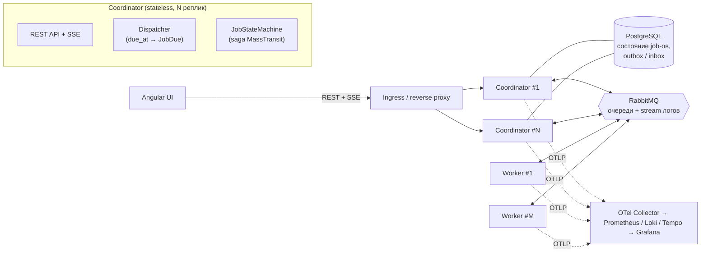
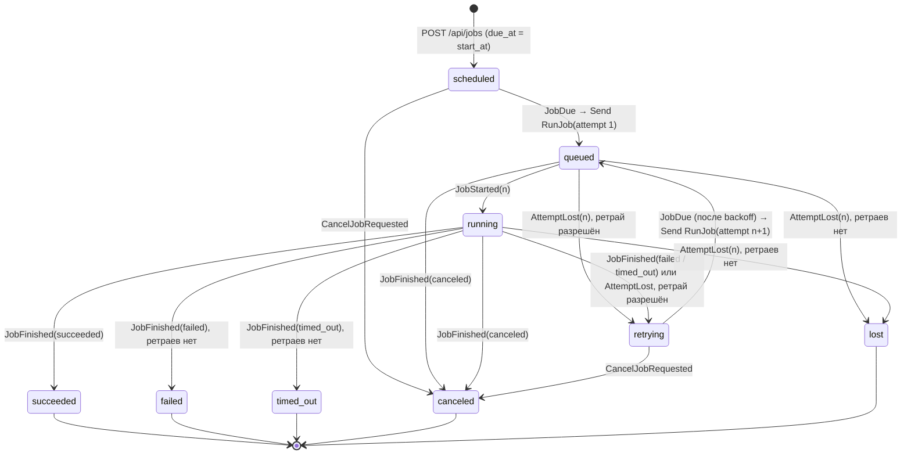
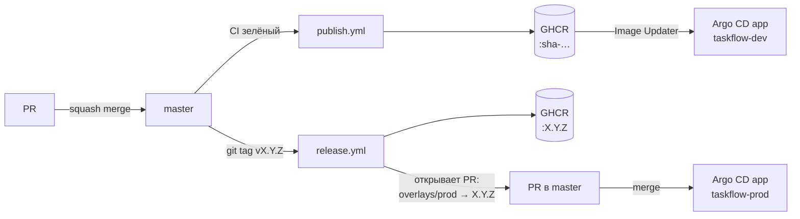
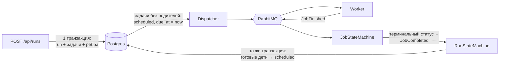

# TaskFlow — спецификация (v1.2)

> **Статус: утверждена, 2026-11-19** (v1.2 — брокер RabbitMQ + MassTransit, хранение на EF Core; см. «История изменений»). Базовая версия для реализации MVP. Новые фичи и изменения — следующими версиями.
> Цель проекта — изучить C#/.NET (переход с C++) на реалистичной распределённой системе, местами «как в проде». С v1.2 стек брокера и доступа к данным совпадает с рабочим: RabbitMQ + MassTransit + EF Core.

---

## 1. Что строим

TaskFlow — распределённый планировщик shell-задач. Пользователь в web-UI создаёт **job**: bash-команду, время старта (`start_at`), таймаут и политику ретраев. Система в нужный момент отдаёт job одному из воркеров. Воркер выполняет команду в изолированном процессе, стримит логи и сообщает результат. Координаторов и воркеров может быть сколько угодно, и любой из них может упасть в любой момент.

### 1.1. Входит в MVP

| # | Возможность |
|---|---|
| F1 | Создать job: `command`, `start_at` (по умолчанию «сейчас»), `timeout`, `retry` |
| F2 | Отложенный запуск по `start_at` (точность ≈ 1 с) |
| F3 | Выполнение `bash -c` в отдельном процессе внутри пода воркера, с таймаутом |
| F4 | Политика ретраев **на уровне job** (`max_attempts`, `retry_on`, `backoff`) |
| F5 | Если воркер умер посреди job-а, это обнаруживается автоматически, и job ретраится или помечается `lost` |
| F6 | Отмена job-а (cancel), и ожидающего, и уже запущенного |
| F7 | Live-tail stdout/stderr в UI (SSE); логи живут в RabbitMQ Stream 24 ч |
| F8 | Список job-ов, карточка job-а с историей попыток, список живых воркеров |
| F9 | N координаторов + M воркеров одновременно, без единой точки отказа в коде |
| F10 | Метрики, трейсы и логи сервисов через OpenTelemetry → Grafana LGTM |
| F11 | Идемпотентное создание: повторный `POST` с тем же `Idempotency-Key` не создаёт второй job |

### 1.2. Не входит в MVP (backlog)

**DAG задач — главное направление после MVP (§15)** · скачивание ресурсов перед стартом · лимиты CPU/памяти (cgroups v2) · несколько job-ов одновременно на воркере · cron/повторяющиеся job-ы · приоритеты · аутентификация (Keycloak/OIDC) · архив логов в MinIO/S3 · автоскейлинг воркеров (KEDA) · lease попытки в saga (обнаружение «зависшего» воркера при живом соединении).

### 1.3. Нефункциональные требования

- **Семантика:**
  - *создание job-а* — **exactly-once**: повтор `POST` с тем же `Idempotency-Key` возвращает уже созданный job (§5, §7);
  - *состояние job-а* — **effectively-once**: saga MassTransit с inbox/outbox (§5) + номер попытки как fencing-токен;
  - *выполнение команды* — **at-most-once по умолчанию** (`max_attempts = 1`): повторно доставленная попытка никогда не запускается (§6.2), job помечается `lost`;
  - **at-least-once — по желанию** для конкретного job-а (`max_attempts > 1`, `retry_on: lost`): при сетевом разделении команда может выполниться дважды (§6.4).

  Вместе это значит: при настройках по умолчанию одно нажатие «Создать» (с любым числом сетевых повторов) приводит максимум к одному запуску команды.
- Ни один компонент не хранит состояние, которое нельзя потерять: координаторы stateless (состояние — в Postgres), воркеры держат только текущий job.
- Любой процесс можно убить `kill -9` в любой момент, и система сойдётся к корректному состоянию.
- ⚠️ **Безопасность.** TaskFlow — по сути «RCE как сервис». Пока нет auth, его **нельзя** выставлять наружу: только localhost или k3d.

---

## 2. Архитектура

### 2.1. Компоненты



| Компонент | Ответственность | Масштабирование |
|---|---|---|
| **Coordinator** | REST API и SSE; **Dispatcher** будит job-ы, у которых наступил `due_at` (старт и backoff ретраев); **JobStateMachine** — saga MassTransit, единственный владелец состояния job-а | N реплик; Dispatcher безопасен благодаря `SKIP LOCKED`, saga — общая очередь `job-state` + пессимистичная блокировка строки |
| **Worker** | Получает `RunJob` из очереди, выполняет процесс, пишет логи в RabbitMQ Stream, публикует события, шлёт heartbeat | M реплик; не знает о координаторах и не ходит в БД |
| **Migrator** | EF Core-миграции **и** создание RabbitMQ Stream для логов | Одноразовый Job перед деплоем |
| **PostgreSQL** | Источник истины: строки saga (= job-ы), попытки, воркеры, таблицы outbox/inbox MassTransit | 1 инстанс (в k8s — CloudNativePG, post-MVP) |
| **RabbitMQ** | Очереди команд и событий (через MassTransit), stream логов job-ов (напрямую) | 1 узел в dev, кластер из 3 в k3d |
| **Angular UI** | Формы, списки, live-логи | Статика за nginx |

### 2.2. Ключевые решения (кратко; подробно в §11 ADR)

1. **Брокер — RabbitMQ, работа с ним — через MassTransit v8** (open source). Очереди — quorum. Исключение — логи job-ов: RabbitMQ Stream через `RabbitMQ.Stream.Client`, потому что MassTransit streams не поддерживает.
2. **Состояние job-а — saga state machine MassTransit**, хранится в Postgres через EF Core. Строка saga и есть job. Обновление состояния и отправка сообщений — в одной транзакции (transactional outbox), повторно доставленные события отсекает inbox.
3. **Каждая попытка — отдельное сообщение `RunJob(attempt = n)`.** Повторно доставленную попытку (`Redelivered = true`) воркер не выполняет, а сообщает `AttemptLost(n)`; новую попытку выдаёт только saga. Отсюда at-most-once по умолчанию и fencing по номеру попытки.
4. **Отложенный старт и backoff — колонка `due_at` + Dispatcher** (поллинг Postgres + `SKIP LOCKED` + NOTIFY), без планировщика MassTransit.
5. **Доступ к данным — EF Core** (+ сырой SQL там, где нужен `SKIP LOCKED` или `ON CONFLICT`), миграции — EF Core migrations.
6. **Воркер общается только с RabbitMQ.** gRPC удалён, координаторы stateless.

---

## 3. Жизненный цикл job-а

### 3.1. Машина состояний



Терминальные статусы: `succeeded`, `failed`, `timed_out`, `canceled`, `lost`. Переходы описаны в одном месте — `JobStateMachine` (MassTransit `MassTransitStateMachine<JobState>`). Событие с `attempt` не равным текущей попытке игнорируется (fencing). Терминальные строки **не удаляются**: `SetCompletedWhenFinalized` не используем, история job-ов нужна.

### 3.2. Счастливый путь

```mermaid
sequenceDiagram
    autonumber
    participant UI as Angular UI
    participant API as Coordinator API
    participant PG as PostgreSQL
    participant D as Dispatcher (любой координатор)
    participant MQ as RabbitMQ
    participant S as JobStateMachine (любой координатор)
    participant W as Worker

    UI->>API: POST /api/jobs (Idempotency-Key)
    API->>PG: INSERT jobs (state=scheduled, due_at=start_at) ON CONFLICT DO NOTHING
    API-->>UI: 201 Created (повтор того же запроса → 200)
    loop каждую ~1 с (+ LISTEN/NOTIFY)
        D->>PG: BEGIN; SELECT … due_at ≤ now() FOR UPDATE SKIP LOCKED
        D->>PG: outbox: JobDue(jobId); UPDATE due_at = null; COMMIT
    end
    PG-->>MQ: доставка outbox → JobDue
    MQ->>S: JobDue
    S->>PG: state=queued, attempt=1, outbox: RunJob(1); COMMIT
    PG-->>MQ: доставка outbox → очередь run-job
    MQ->>W: RunJob(1), Redelivered = false
    W->>MQ: Publish JobStarted(1)
    W->>W: bash -c command (таймаут, логи → stream taskflow.job-logs)
    W->>MQ: Publish JobFinished(1, succeeded)
    W->>MQ: ack RunJob (после подтверждения публикации)
    MQ->>S: JobStarted, JobFinished
    S->>PG: running → succeeded, job_attempts, outbox: JobStatusChanged; COMMIT
    PG-->>MQ: JobStatusChanged (fanout на все координаторы)
    MQ-->>API: JobStatusChanged
    API-->>UI: SSE: job updated → UI перезапрашивает job
```

### 3.3. Сбои

| Сценарий | Что происходит |
|---|---|
| Клиент не дождался ответа на `POST` и повторил его | Тот же `Idempotency-Key` → `ON CONFLICT` → возвращается существующий job (`200`), второй не создаётся |
| Координатор упал во время транзакции Dispatcher-а или saga | Транзакция откатилась: ни состояние, ни сообщения из outbox не записаны. Событие не ack-нуто → повторная доставка, другой координатор обработает |
| Координатор упал после COMMIT, но до доставки outbox | Сообщения лежат в outbox-таблице, их доставит outbox-сервис любого координатора |
| Событие доставлено повторно | Inbox MassTransit отсекает по `MessageId`; плюс saga игнорирует события с устаревшим `attempt` |
| Под воркера убит (`kill -9`, OOM) | ОС закрывает TCP → RabbitMQ сразу возвращает `RunJob(n)` в очередь → другой воркер получает его с `Redelivered = true`, **не запускает**, публикует `AttemptLost(n)` → saga: ретрай (`retrying`, `due_at = now + backoff`) или `lost` |
| Сеть до воркера пропала, процесс жив | RabbitMQ замечает по heartbeat (10–15 с) и возвращает `RunJob` в очередь — дальше как выше. Воркер, потеряв соединение, сам убивает процесс (self-fencing): ack по старому каналу уже невозможен |
| Соединение живо, но код воркера завис | Ловится только `consumer_timeout` очереди `run-job` (выше максимального таймаута job-а). Известное ограничение MVP; дальше — lease попытки в saga |
| Команда завершилась с exit ≠ 0 | `JobFinished(failed)`; saga: если `retry_on` содержит `failed` и попытки остались → `retrying` с backoff, иначе `failed` |
| Таймаут | SIGTERM → 10 с grace → SIGKILL всего дерева процессов; `JobFinished(timed_out)` |
| Два координатора одновременно обрабатывают события одного job-а | Пессимистичная блокировка строки saga (`SELECT … FOR UPDATE`) — второй ждёт; Dispatcher такие строки пропускает (`SKIP LOCKED`) |
| Воркер получает SIGTERM (rolling update) | Перестаёт брать новые сообщения; ждёт текущий job до `ShutdownJobWait` (25 с), затем убивает процесс и публикует `JobFinished(failed, error = worker_shutdown)` |
| Все воркеры мертвы | `RunJob` копится в очереди, job-ы в `queued`. Система восстанавливается сама, когда поднимается воркер; ловится алертом (§9) |

---

## 4. RabbitMQ-топология и сообщения

### 4.1. Очереди и exchange-и

Exchange-и и очереди MassTransit создаёт сам при старте сервисов (имена — kebab-case через `KebabCaseEndpointNameFormatter`). Отдельно создаётся только stream логов (Migrator).

| Очередь / stream | Тип | Кто слушает | Что приходит | Настройки |
|---|---|---|---|---|
| `run-job` | quorum | воркеры (competing consumers) | `RunJob` | `PrefetchCount = 1`, `ConcurrentMessageLimit = 1`; `x-consumer-timeout` выше максимального таймаута job-а (§13); **без** retry/redelivery MassTransit (§6.2) |
| `job-state` | quorum | saga во всех координаторах | `JobDue`, `JobStarted`, `JobFinished`, `AttemptLost`, `CancelJobRequested` | retry только на конфликт блокировки/БД; inbox + outbox на EF Core |
| `worker-heartbeat` | quorum | координаторы (competing) | `WorkerHeartbeat` | пишет в таблицу `workers` |
| `worker-control-{workerId}` | временная, auto-delete | конкретный воркер | `CancelJob` (fanout всем воркерам) | создаётся на каждый экземпляр воркера |
| `coordinator-ui-{instanceId}` | временная, auto-delete | конкретный координатор | `JobStatusChanged` (fanout) | пересылка своим SSE-клиентам |
| `taskflow.job-logs` | **stream** | SSE-подключения координаторов | пачки строк логов | `x-max-age` 24 ч, `x-max-length-bytes` 1 GiB; протокол stream (порт 5552) |

### 4.2. Сообщения

Все контракты — `record`-ы в `TaskFlow.Contracts`. Сериализация — System.Text.Json (по умолчанию в MassTransit). Имена типов и namespace — часть контракта: MassTransit строит из них имена exchange-ей, поэтому переименование ломает маршрутизацию (при необходимости — `[EntityName]` / `[MessageUrn]`). Трейс-контекст MassTransit передаёт в заголовках сам.

```csharp
// команда, очередь run-job; отправляет только saga
public sealed record RunJob(
    Guid JobId, int Attempt, string Command, int TimeoutSeconds);

// события в job-state
public sealed record JobDue(Guid JobId);                                   // Dispatcher
public sealed record JobStarted(Guid JobId, int Attempt, string WorkerId, DateTimeOffset StartedAt);
public sealed record JobFinished(Guid JobId, int Attempt, string WorkerId,
                                 JobResult Result, int? ExitCode, string? Error,
                                 DateTimeOffset FinishedAt);               // Succeeded | Failed | TimedOut | Canceled
public sealed record AttemptLost(Guid JobId, int Attempt, string ReportedBy);
public sealed record CancelJobRequested(Guid JobId);                       // API

// fanout
public sealed record CancelJob(Guid JobId);                                // saga → все воркеры
public sealed record JobStatusChanged(Guid JobId, string Status);          // saga → все координаторы
public sealed record WorkerHeartbeat(string WorkerId, string Host,
                                     Guid? RunningJobId, DateTimeOffset At);

// stream taskflow.job-logs (не MassTransit; JSON через STJ source generation)
public sealed record LogBatch(Guid JobId, int Attempt, long FirstSeq, IReadOnlyList<LogLine> Lines);
public sealed record LogLine(LogStream Stream, DateTimeOffset Ts, string Text);   // Text ≤ 8 KiB
```

`attempt` выдаёт saga (§5.2). Это **fencing token**: saga применяет только события текущей попытки.

---

## 5. Данные (PostgreSQL, EF Core)

### 5.1. Модель

Один `TaskFlowDbContext` в проекте `TaskFlow.Persistence` (его используют Coordinator и Migrator). Схема создаётся EF Core-миграциями. Старые DbUp-скрипты `001`–`003` удаляются: данных нет.

```csharp
public sealed class JobState : SagaStateMachineInstance      // таблица jobs
{
    public Guid CorrelationId { get; set; }                  // = JobId, PK (UUIDv7)
    public string CurrentState { get; set; } = null!;        // scheduled / queued / running / …

    public string Command { get; set; } = null!;
    public DateTimeOffset StartAt { get; set; }
    public int TimeoutSeconds { get; set; }
    public int MaxAttempts { get; set; } = 1;
    public RetryOn RetryOn { get; set; } = RetryOn.Lost;     // [Flags]
    public int BackoffSeconds { get; set; }

    public int CurrentAttempt { get; set; }
    public DateTimeOffset? DueAt { get; set; }               // когда Dispatcher должен разбудить
    public string? WorkerId { get; set; }
    public int? ExitCode { get; set; }
    public string? Error { get; set; }
    public DateTimeOffset? CancelRequestedAt { get; set; }

    public string? IdempotencyKey { get; set; }
    public byte[]? RequestHash { get; set; }

    public DateTimeOffset CreatedAt { get; set; }
    public DateTimeOffset? FinishedAt { get; set; }
    public DateTimeOffset UpdatedAt { get; set; }
}
```

| Таблица | Что | Ключи и индексы |
|---|---|---|
| `jobs` | строка saga = job | PK `correlation_id`; частичный индекс `due_at where due_at is not null`; уникальный частичный `idempotency_key where idempotency_key is not null`; `(current_state, correlation_id desc)` для списков |
| `job_attempts` | история попыток: `job_id`, `attempt`, `worker_id`, `started_at`, `finished_at`, `result`, `exit_code` | PK `(job_id, attempt)` |
| `workers` | heartbeat-ы: `id`, `host`, `running_job_id`, `last_seen_at` | PK `id`; «живой» = `last_seen_at > now() - 15 s` |
| `inbox_state`, `outbox_message`, `outbox_state` | таблицы MassTransit (`AddInboxStateEntity`, `AddOutboxMessageEntity`, `AddOutboxStateEntity`) | создаются той же миграцией |

Saga-репозиторий MassTransit: EF Core, **пессимистичная** конкурентность (`ConcurrencyMode.Pessimistic`) и Postgres-блокировки (`UsePostgres()`): по умолчанию MassTransit генерирует блокировки в стиле SQL Server.

### 5.2. Как saga выдаёт попытки

```
событие AttemptLost(n) или JobFinished(n, failed/timed_out):
  n != CurrentAttempt                         → игнорировать (устаревшее/дубль)
  ретрай разрешён (retry_on) и n < MaxAttempts → state = retrying, DueAt = now + backoff
  иначе                                       → терминальный статус (lost / failed / timed_out)

событие JobDue:
  state = scheduled → CurrentAttempt = 1;   state = queued; Send RunJob(attempt 1)
  state = retrying  → CurrentAttempt += 1;  state = queued; Send RunJob(attempt n+1)
  иначе             → игнорировать (job отменён или уже идёт)
```

Всё это — одна транзакция: строка saga + запись в `outbox_message` (+ `inbox_state` для входящего события). После COMMIT outbox-сервис отправляет `RunJob` в RabbitMQ. Отправить сообщение, «забыв» сохранить состояние, или наоборот — невозможно.

### 5.3. Создание с Idempotency-Key

Ключ генерирует клиент (UI — `crypto.randomUUID()` один раз на отправку формы; `curl`/скрипты — свой UUID). Генерировать его на прокси бессмысленно: повтор — это новый HTTP-запрос. Ключ необязателен.

API вставляет строку saga напрямую (`state = scheduled`, `DueAt = StartAt`): для создания job-а событие не нужно, его разбудит Dispatcher. Два шага — обычный путь (новый ключ) — один запрос, повтор — два:

```sql
-- шаг 1 (EF Core: Database.SqlQuery<Guid>($"…"))
insert into jobs (correlation_id, current_state, idempotency_key, request_hash, command, start_at, due_at, …)
values (@Id, 'scheduled', @Key, @Hash, @Command, @StartAt, @StartAt, …)
on conflict (idempotency_key) where idempotency_key is not null do nothing
returning correlation_id;

-- шаг 2, только если шаг 1 вернул 0 строк (EF Core: LINQ, AsNoTracking)
select correlation_id, request_hash from jobs where idempotency_key = @Key;
```

Почему не в один запрос:
- `RETURNING` при `ON CONFLICT DO NOTHING` возвращает **0 строк**, а не существующую запись.
- Трюк `ON CONFLICT DO UPDATE … RETURNING` каждый повтор физически перезаписывает строку и берёт её блокировку.
- CTE «вставь или прочитай» в одном операторе ловит гонку: в `READ COMMITTED` снимок берётся на весь оператор, и строку, закоммиченную конкурентом, `select` в том же операторе не увидит.

Альтернатива на чистом EF Core — `SaveChangesAsync` и перехват `DbUpdateException` с `PostgresException.SqlState == "23505"`; подходит, но проще ошибиться в обработке.

**Отпечаток запроса (`request_hash`).** SHA-256 от канонической формы **разобранного** запроса (DTO → JSON через source-gen контекст → `SHA256.HashData`). ⚠ Хэшируем запрос **как пришёл, до подстановки значений по умолчанию**: если `startAt` не передан, хэшируется `null`, а не `now()`.

**Конкурентные повторы.** Второй запрос с тем же ключом ждёт на уникальном индексе, затем идёт по ветке «повтор» → `200`. `409 Conflict` не нужен.

**Хранение ключей.** В MVP — вместе с job-ом, бессрочно. С появлением auth индекс станет `(owner_id, idempotency_key)`.

### 5.4. Dispatcher

Будит job-ы, у которых наступил `due_at`: и первый старт по `start_at`, и следующую попытку после backoff. Транзакция короткая: публикация идёт **в outbox-таблицу той же транзакции**, а не по сети.

```
BEGIN
  SELECT correlation_id FROM jobs
   WHERE due_at <= now()
   ORDER BY due_at
   FOR UPDATE SKIP LOCKED
   LIMIT 50;                                   ← строки, которые держит saga, пропускаются
  для каждой: Publish JobDue(jobId)            ← bus outbox: INSERT в outbox_message
  UPDATE jobs SET due_at = null WHERE correlation_id = ANY(@ids)
COMMIT                                         ← после COMMIT outbox-сервис отправит JobDue
```

В EF Core: `BeginTransactionAsync` → `FromSql` (с `FOR UPDATE SKIP LOCKED`) → `IPublishEndpoint.Publish` (bus outbox пишет в тот же `DbContext`) → `ExecuteUpdateAsync` → `SaveChangesAsync` → `CommitAsync`.

- **`LIMIT 50` + `SKIP LOCKED`** делит работу между координаторами: никто никого не ждёт, ни одна строка не достаётся двоим.
- **Процесс упал до COMMIT** → откат, `due_at` остался, следующий тик обработает снова.
- **`JobDue` пришёл дважды** (Dispatcher снова поднял строку, пока saga ещё не обработала первый) — saga игнорирует `JobDue` вне состояний `scheduled`/`retrying`.
- Чтобы задержка была меньше секунды, триггер на изменение `due_at` делает `pg_notify('jobs_due', '')`; Dispatcher слушает канал через `NpgsqlConnection.WaitAsync`. Поллинг раз в секунду остаётся страховкой.
- Страховка от зависшей сессии: `idle_in_transaction_session_timeout = 30 s` для соединений Dispatcher-а.

### 5.5. Cancel

API публикует `CancelJobRequested(jobId)` (через bus outbox) и отвечает `202`, для терминального job-а — `409`. Дальше решает saga:
- `scheduled` / `retrying` → `canceled`, `DueAt = null`;
- `queued` / `running` → `CancelRequestedAt = now`, Publish `CancelJob(jobId)` всем воркерам. Финальный `canceled` придёт событием `JobFinished(canceled)` от воркера;
- если после отмены приходит `JobStarted` (воркер перезапускался и пропустил `CancelJob`) — saga ещё раз публикует `CancelJob`.

---

## 6. Worker

### 6.1. Внутреннее устройство

```
Worker (generic host + MassTransit)
 ├─ RunJobConsumer       очередь run-job: Redelivered? → JobStarted → выполнение → JobFinished
 ├─ CancelJobConsumer    временная очередь worker-control-{id}: отмена текущего / запомнить id
 ├─ HeartbeatService     Publish WorkerHeartbeat каждые 5 с
 ├─ ConnectionWatcher    потеря соединения с RabbitMQ → отменить текущий job (self-fencing)
 └─ JobExecution
     ├─ ProcessRunner    /bin/bash -c, свой workdir, своё дерево процессов
     ├─ LogPump          stdout/stderr → Channel<LogLine> → батчи → RabbitMQ Stream (RabbitMQ.Stream.Client)
     └─ Signals          P/Invoke kill(pid, SIGTERM) → grace → Process.Kill(entireProcessTree: true)
```

`WorkerId` = имя пода (`Environment.MachineName`), а не константа из env.

### 6.2. Обработка `RunJob`

```
Consume(RunJob job):
  if context.ReceiveContext.Redelivered     → Publish AttemptLost(job.JobId, job.Attempt); return   // ack, НЕ запускать
  if job.JobId в локальном списке отменённых → Publish JobFinished(canceled);              return
  Publish JobStarted(job.Attempt)
  result = RunProcess(job, timeout, cancelToken)       // LogPump параллельно
  flush logs
  Publish JobFinished(job.Attempt, result)
  return                                               // MassTransit делает ack после выхода из Consume
```

- `Redelivered` выставляет **RabbitMQ**, если сообщение уже кому-то доставлялось и вернулось в очередь без ack. Флаг консервативен: попытка засчитывается потерянной, даже если прежний воркер умер до старта процесса.
- ⚠ На endpoint `run-job` **нельзя** включать `UseMessageRetry` (повтор в памяти = незаметный повторный запуск команды) и `UseDelayedRedelivery` (отправляет новую копию с `Redelivered = false`, защита ломается). Исключение из `Consume` → сообщение уходит в `run-job_error`, saga узнаёт о проблеме по `AttemptLost`/`lost` от следующей доставки или по алерту.
- Публикации ждут подтверждения брокера (publisher confirms включены в MassTransit по умолчанию), поэтому ack `RunJob` происходит только после того, как `JobFinished` принят RabbitMQ.
- Если воркер упал после публикации `JobFinished`, но до ack, `RunJob` вернётся в очередь, следующий воркер пришлёт `AttemptLost(n)`, а saga его проигнорирует: попытка `n` уже завершена.

### 6.3. Изоляция процесса (MVP)

- Отдельный workdir `/var/lib/taskflow/jobs/<jobId>/<attempt>` (emptyDir в k8s), удаляется после завершения.
- Чистое окружение: только `PATH`, `HOME=workdir`, `TASKFLOW_JOB_ID`, `TASKFLOW_ATTEMPT`. Пара `(TASKFLOW_JOB_ID, TASKFLOW_ATTEMPT)` — idempotency/fencing-ключ для внешних систем (§6.4).
- Контейнер воркера запускается non-root, rootfs read-only, кроме workdir и `/tmp`.
- Убиваем всё дерево процессов (`entireProcessTree`), чтобы `bash -c "sleep 999 &"` не оставлял сирот.
- Post-MVP: cgroup v2 на каждый job (`memory.max`, `cpu.max`) или `nsjail`/`bubblewrap`; скачивание ресурсов в workdir с проверкой checksum.

### 6.4. At-most-once и at-least-once: когда возможен двойной запуск

**At-most-once (по умолчанию, `max_attempts = 1`).** Повторно доставленный `RunJob` никогда не запускается (§6.2), а новую попытку saga не выдаёт. Двойного выполнения нет; цена — job может закончиться `lost`, даже если «зависший» воркер на самом деле доработал до конца (его поздний `JobFinished` отбрасывается: статус уже терминальный).

**At-least-once (`max_attempts > 1`, `retry_on` содержит `lost`).** Если воркер жив, но RabbitMQ счёл соединение мёртвым (сеть, долгая пауза GC), saga выдаст попытку `n+1` другому воркеру, пока первый ещё выполняет команду. Защита:
- self-fencing: потеряв соединение, воркер убивает свой процесс — ack по старому каналу всё равно невозможен;
- fencing по `attempt`: saga применяет только события текущей попытки;
- в этом режиме **команды должны быть идемпотентными** (ключ для внешних систем — `TASKFLOW_JOB_ID`).

`Idempotency-Key` (§5.3) защищает от дублей на входе, а правило `Redelivered` — от дублей при выполнении.

---

## 7. Coordinator API

| Метод | Путь | Описание |
|---|---|---|
| POST | `/api/jobs` | Создать job (заголовок `Idempotency-Key` — необязательный) → см. таблицу ответов ниже |
| GET | `/api/jobs?status=&limit=50&after=<id>` | Список, keyset-пагинация по UUIDv7 |
| GET | `/api/jobs/{id}` | Job + попытки |
| POST | `/api/jobs/{id}/cancel` | `202 Accepted` (решение принимает saga); `409`, если job уже терминальный |
| GET | `/api/jobs/{id}/logs/stream` | SSE: история из RabbitMQ Stream (до 24 ч) + live |
| GET | `/api/events/stream` | SSE: `job-updated {jobId, status}` |
| GET | `/api/workers` | Живые воркеры из таблицы `workers` |
| GET | `/healthz/live`, `/healthz/ready` | k8s-пробы (ready = есть Postgres и RabbitMQ; MassTransit регистрирует свои health checks) |
| GET | `/openapi/v1.json` | OpenAPI (встроенный `Microsoft.AspNetCore.OpenApi`) + Scalar UI в dev |

Пример запроса:

```json
POST /api/jobs
Idempotency-Key: 6f1c2a1e-8a52-4d3b-9a0e-2b7f0c9d4e11

{
  "command": "echo hello && sleep 5",
  "startAt": "2026-11-17T12:00:00Z",
  "timeoutSeconds": 60,
  "retry": { "maxAttempts": 3, "retryOn": ["lost", "failed"], "backoffSeconds": 10 }
}
```

Ответы `POST /api/jobs`:

| Ситуация | Ответ |
|---|---|
| Новый ключ (или ключа нет) | `201 Created` + `Location: /api/jobs/{id}`, в теле — job |
| Тот же ключ, тот же отпечаток | `200 OK` + `Idempotent-Replayed: true`, в теле — **текущее** состояние job-а. Клиент обрабатывает `200` и `201` одинаково |
| Тот же ключ, другой отпечаток | `422` ProblemDetails: «ключ уже использован для другого запроса» |
| Ключ некорректен (пустой, > 128 символов, непечатные символы) | `400` |
| Тело невалидно | `400` ValidationProblem; в БД ничего не попало — можно исправить тело и повторить с тем же ключом |
| Postgres недоступен | `503`; ничего не сохранено — повтор с тем же ключом безопасен |

Порядок проверок: формат ключа → валидация тела → `INSERT` → при конфликте сравнение отпечатков. Для SSE — встроенный `TypedResults.ServerSentEvents` из ASP.NET Core 10 + `IAsyncEnumerable`.

**Live-логи.** SSE-подключение открывает consumer RabbitMQ Stream (`RabbitMQ.Stream.Client`) с offset по времени старта попытки, фильтрует пачки по `JobId` и отдаёт их клиенту; consumer закрывается вместе с подключением.

---

## 8. Angular UI

- Актуальный Angular: standalone-компоненты, signals, Angular Material.
- TS-клиент генерируется из OpenAPI (`ng-openapi-gen` или `orval`), руками DTO не пишем.
- Страницы:
  1. **Jobs** — таблица со статусами, фильтр, live-обновление через `/api/events/stream`.
  2. **New job** — форма (command, start_at, timeout, retry; переключатель «at-most-once / at-least-once» управляет `maxAttempts`/`retryOn`). `Idempotency-Key` создаётся при отправке формы и переиспользуется при ретраях `HttpClient` и повторном клике, пока ждём ответа; после успеха сбрасывается.
  3. **Job details** — поля, попытки, кнопка Cancel, терминал с live-логами (`EventSource`, автоскролл, stdout/stderr разными цветами).
  4. **Workers** — список живых воркеров (`/api/workers`).
- Dev: `ng serve` с `proxy.conf.json` → `http://localhost:8080`. Prod: nginx-образ, Ingress маршрутизирует `/api` → coordinator, `/` → ui.

---

## 9. Observability

Все сервисы подключают общий проект `TaskFlow.ServiceDefaults` (OTel + health checks, по образцу Aspire).

**Трейсы:** ASP.NET Core, HttpClient, Npgsql / EF Core и **MassTransit** (`AddSource("MassTransit")`). MassTransit сам передаёт трейс-контекст в заголовках сообщений, поэтому один трейс тянется `POST /api/jobs → Dispatcher → saga → RunJob → worker → saga` без ручной работы. Логи job-ов идут мимо MassTransit: в `LogBatch` трейс-контекст не нужен.

**Метрики** (`Meter("TaskFlow")` + встроенный `Meter("MassTransit")`):

| Метрика | Тип | Где |
|---|---|---|
| `taskflow.jobs.submitted` | counter | API |
| `taskflow.jobs.idempotent_replays{result=replayed\|mismatch}` | counter | API |
| `taskflow.jobs.dispatched` | counter | Dispatcher |
| `taskflow.jobs.finished{result}` | counter | saga |
| `taskflow.job.schedule_lag` (start_at → started) | histogram, s | saga |
| `taskflow.job.duration` | histogram, s | Worker |
| `taskflow.job.attempts_lost` | counter | Worker (`Redelivered` → `AttemptLost`) |
| `taskflow.worker.busy` | up-down counter | Worker |

Плюс метрики MassTransit (время обработки, ошибки по consumer-ам), .NET runtime и Kestrel. RabbitMQ: встроенный Prometheus-плагин `rabbitmq_prometheus` (длины очередей, unacked, consumers).

**Алерты** (вместо watchdog в коде, §16):

| Метрика | Алерт, когда… | Что ловит |
|---|---|---|
| Возраст самого старого `queued` job-а | > 1–2 мин | Воркеров нет или они не успевают |
| Число `running` job-ов, где `now > started_at + timeout + grace` | > 0 | Застрявшие job-ы (зависший воркер при живом соединении, пропавшее сообщение) |
| Число живых воркеров (таблица `workers`) | = 0 при непустой `run-job` | Все воркеры мертвы |
| Сообщения в `*_error` очередях | > 0 | Исключения в consumer-ах |

Метрики из Postgres считаются запросом (`ObservableGauge`); при N координаторах в Grafana и алертах берём `max()`, а не `sum()`.

**Логи сервисов:** `ILogger` → OTel logs → Loki, структурированные, со scope `{JobId, Attempt, WorkerId}`. Логи *job-ов* (stdout команды) идут отдельно через RabbitMQ Stream и в Loki не попадают.

**Стек:** локально — один контейнер `grafana/otel-lgtm` (Collector + Prometheus + Loki + Tempo + Grafana). В k3d — тот же образ в MVP; дашборд `TaskFlow Overview` хранится как JSON в `deploy/grafana/`.

---

## 10. Разработка и деплой

### 10.1. Dev loop (compose для разработки, k3d — для «как в проде»)

| Режим | Команда | Когда |
|---|---|---|
| **Инфра в compose, сервисы из Rider** | `docker compose up postgres rabbitmq lgtm migrator` | Каждый день: отладка, брейкпоинты, hot reload |
| **Всё в compose** | `docker compose --profile full up --scale worker=3 --scale coordinator=2` (+ Caddy/nginx перед координаторами) | Быстрая проверка нескольких инстансов |
| **k3d** | `make k3d-up && make deploy` | Rolling update, chaos-тесты, Ingress, кластер RabbitMQ |

RabbitMQ в compose: образ `rabbitmq:4-management` с включёнными плагинами `rabbitmq_stream` и `rabbitmq_prometheus`; порты 5672 (AMQP), 5552 (stream), 15672 (management UI), 15692 (метрики).

### 10.2. Kubernetes (k3d)

```
deploy/k8s/
  base/                 # kustomize
    coordinator/        Deployment (replicas 2), Service, ConfigMap, probes
    worker/             Deployment (replicas 3), terminationGracePeriodSeconds: 60, emptyDir
    migrator/           Job (Argo CD PreSync hook)
    ui/                 Deployment (nginx), Service
    ingress.yaml        Traefik (встроен в k3s)
    lgtm/               otel-lgtm Deployment
    rabbitmq.yaml       RabbitmqCluster (3 узла, плагины stream и prometheus)
  overlays/
    dev/                namespace taskflow-dev, образы из master (обновляет Argo CD Image Updater)
    prod/               namespace taskflow-prod, образы с тегом релиза (меняются только через PR)
  argocd/               Application-ы taskflow-dev и taskflow-prod, настройки Image Updater
```

- Свои сервисы описываем через **kustomize**, сторонние операторы ставим **Helm**-чартами.
- RabbitMQ — официальный **RabbitMQ Cluster Operator** (`RabbitmqCluster`), quorum-очереди и stream реплицируются на 3 узла.
- Postgres в MVP — простой StatefulSet; позже CloudNativePG-оператор.
- Образы: в «как в проде»-режиме — из GitHub Container Registry, выкатку делает Argo CD (§10.5). Для быстрой локальной проверки без CI — `k3d image import`.
- Post-MVP: **KEDA** со скейлером RabbitMQ масштабирует воркеров по длине очереди `run-job`.

### 10.3. Структура репозитория

```
TaskFlow/
  global.json  Directory.Build.props  Directory.Packages.props  .editorconfig
  TaskFlow.slnx
  src/
    TaskFlow.Coordinator/   Api/ Sagas/ Dispatching/ Logs/ Workers/
    TaskFlow.Worker/        Consumers/ Execution/ Logs/ Hosting/
    TaskFlow.Contracts/     сообщения MassTransit, LogBatch, имена очередей/stream
    TaskFlow.Persistence/   TaskFlowDbContext, сущности, конфигурации EF Core, миграции
    TaskFlow.ServiceDefaults/
    TaskFlow.Migrator/      применяет миграции EF Core + создаёт stream логов
  ui/taskflow-ui/
  tests/
    TaskFlow.UnitTests/           xUnit, FakeTimeProvider, MassTransit test harness
    TaskFlow.IntegrationTests/    Testcontainers (PostgreSql, RabbitMq)
  deploy/  compose/  k8s/  grafana/
  .github/  workflows/ (ci.yml, publish.yml, release.yml)  pull_request_template.md
  docs/  spec.md  git-workflow.md  adr/
```

`Directory.Build.props`: `Nullable=enable`, `TreatWarningsAsErrors=true`, `AnalysisLevel=latest-recommended`, `EnforceCodeStyleInBuild=true`. Версии пакетов — только в `Directory.Packages.props`. MassTransit — ветка **v8** (Apache 2.0); v9 коммерческая.

### 10.4. Тесты

- **Unit:** `JobStateMachine` через **MassTransit test harness** (`AddMassTransitTestHarness`, in-memory: отправил событие → проверил состояние и отправленные сообщения), правила ретраев, батчинг логов, валидация API. Время подменяем через `FakeTimeProvider`.
- **Integration (Testcontainers):** Postgres + RabbitMQ в контейнерах. Dispatcher с двумя конкурентными инстансами (каждый job разбужен ровно один раз); saga при повторной доставке событий (inbox); воркер: timeout, cancel, правило `Redelivered`.
- **E2E/chaos (в k3d, вручную или скриптом):** см. §12.

### 10.5. Процесс разработки: git и CI/CD

**Git — trunk-based** (подробности в `docs/git-workflow.md`):
- одна долгоживущая ветка `master`, всегда зелёная и готовая к выкатке; прямой push запрещён;
- короткоживущие ветки `<тип>/<issue>-<описание>`, PR = одно связное изменение (`Closes #N` или `Part of #N`);
- squash merge, заголовок PR в формате Conventional Commits; правки спеки — отдельными PR;
- контуры задаются окружениями и тегами, а не ветками: **dev** = последний `master`, **prod** = тег `vX.Y.Z`.

**CI** — GitHub Actions, `ci.yml`, на каждый PR и push в `master`:

| Шаг | Что проверяет |
|---|---|
| restore (с кешем NuGet) | зависимости |
| build | компиляция, предупреждения = ошибки |
| `dotnet format --verify-no-changes` | стиль |
| unit + integration тесты (Testcontainers) | поведение; Docker на `ubuntu-latest` есть |
| `docker build` без публикации | Dockerfile-ы не сломаны |
| (с M4) Angular: lint, test, build | UI |

Проверки CI — обязательные для merge в `master` (ruleset). Один прогон — не дольше ~10 минут.

**CD, публикация образов** — `publish.yml`, в GitHub Container Registry (`ghcr.io/<owner>/taskflow-<сервис>`):

| Событие | Теги образа |
|---|---|
| merge в `master` | `:master`, `:sha-<короткий sha>` |
| git-тег `vX.Y.Z` | `:X.Y.Z`, `:X.Y` |

**CD, выкатка — GitOps через Argo CD** в k3d. Кластер сам тянет состояние из репозитория и реестра; GitHub до локального кластера доступа не имеет и не должен иметь.



- **dev** (`taskflow-dev`, `overlays/dev`): Argo CD Image Updater следит за `:sha-*` в GHCR и выкатывает новый образ после каждого merge, без коммитов в репозиторий.
- **prod** (`taskflow-prod`, `overlays/prod`): версия образов записана в git. Релиз: тег `vX.Y.Z` → `release.yml` публикует образы и открывает PR, меняющий тег в `overlays/prod` → merge этого PR → Argo CD синхронизирует prod. Откат — PR с предыдущей версией (или `git revert`).
- Миграции БД в k8s выполняются как Argo CD sync hook (Job `migrator` в фазе `PreSync`), чтобы схема и streams обновлялись до выкатки сервисов.
- Если репозиторий и пакеты GHCR приватные — нужен `imagePullSecret` и доступ Argo CD к репозиторию (deploy key только на чтение).

**Кто пишет:** workflow-ы и манифесты Argo CD пишет автор проекта (это часть обучения), Claude ревьюит.

---

## 11. ADR (архитектурные решения)

### ADR-1. Брокер и фреймворк: RabbitMQ + MassTransit (пересмотрено в v1.2)
- **Было (v1.0–v1.1):** NATS JetStream для всего — work-queue с `AckProgress`, stream логов, KV.
- **Почему пересмотрели:** MassTransit нужен для работы, а транспорта для NATS у него нет (официальные — RabbitMQ, Azure Service Bus, Amazon SQS). Рабочий стек — RabbitMQ.
- **Решение:** RabbitMQ 4.x + MassTransit v8. Quorum-очереди для команд и событий, RabbitMQ Stream для логов job-ов (через `RabbitMQ.Stream.Client`, мимо MassTransit).
- **Что заменили:**

  | NATS | RabbitMQ + MassTransit |
  |---|---|
  | `AckProgress` (аренда) | соединение + heartbeat; `consumer_timeout` очереди — страховка |
  | `NumDelivered` как номер попытки | `attempt` выдаёт saga, повторная доставка определяется по `Redelivered` (ADR-10) |
  | `Nak(delay)` для backoff | `due_at` + Dispatcher (ADR-4) |
  | `Nats-Msg-Id` + дедупликация | outbox/inbox MassTransit на EF Core (ADR-3) |
  | KV воркеров и отмен | события `WorkerHeartbeat` (таблица `workers`) и `CancelJob` (fanout) |
  | stream логов | RabbitMQ Stream (ADR-11) |
- **Цена:** нет продления аренды — «зависший код при живом соединении» ловится только `consumer_timeout`; два клиента RabbitMQ (MassTransit и Stream).

### ADR-2. Убрать gRPC Worker↔Coordinator
- **Проблема:** стрим привязывал воркера к конкретному координатору; отмену или назначение надо было маршрутизировать к «правильному» инстансу; реестр жил в памяти.
- **Решение:** весь обмен идёт через брокер; воркер не знает адресов координаторов. Сделано в M0 (#3).

### ADR-3. Состояние job-а — saga state machine MassTransit
- **Было:** воркер публикует события, Projector применяет их к Postgres, свой inbox `processed_messages`.
- **Решение:** `JobStateMachine` (MassTransit) — единственный владелец состояния; строка saga = job. EF Core-репозиторий с пессимистичной блокировкой; inbox/outbox MassTransit делают «обновить состояние + отправить сообщения» атомарным и отсекают повторные события.
- **Цена:** eventual consistency — UI видит статус с задержкой в доли секунды (outbox доставляет после COMMIT).

### ADR-4. Отложенный старт и backoff — `due_at` + Dispatcher, а не планировщик MassTransit
- **Рассматривали:** `Schedule` в saga через планировщик MassTransit (плагин delayed message exchange в RabbitMQ или Quartz.NET).
- **Решение:** колонка `due_at` на строке saga; Dispatcher в каждом координаторе поднимает созревшие строки (`FOR UPDATE SKIP LOCKED`) и публикует `JobDue` через bus outbox. Один механизм и для `start_at`, и для backoff ретраев.
- **Почему:** не нужен ещё один компонент или плагин; очередь отложенных job-ов видна SQL-запросом; отмена — просто `due_at = null`.

### ADR-5. Сериализация: JSON (System.Text.Json)
- Сообщения MassTransit — его стандартный JSON-конверт на System.Text.Json, читается глазами в management UI RabbitMQ.
- `LogBatch` для stream — JSON через source-generated `JsonSerializerContext` (без reflection).

### ADR-6. Доступ к данным: EF Core + EF migrations (пересмотрено в v1.2)
- **Было:** Dapper + DbUp.
- **Почему пересмотрели:** готовые хранилище saga и outbox/inbox MassTransit есть для EF Core; Dapper-репозиторий saga в MassTransit рассчитан на SQL Server, а outbox для Dapper нет.
- **Решение:** EF Core (Npgsql) для всего; сырой SQL через EF Core там, где нужен `FOR UPDATE SKIP LOCKED` или `ON CONFLICT`. Миграции — EF Core migrations в `TaskFlow.Persistence`, применяет Migrator.
- **Цена:** переписать репозиторий и миграции; учить EF Core и MassTransit одновременно.

### ADR-7. `Idempotency-Key` в MVP; выполнение at-most-once по умолчанию
- **Цель:** одно действие пользователя → максимум один запуск команды, даже если HTTP-запрос повторился (таймаут, двойной клик, обрыв сети).
- **Решение:** клиент присылает `Idempotency-Key`; уникальный частичный индекс + `ON CONFLICT DO NOTHING` + отпечаток тела дают exactly-once *создание* job-а. Выполнение — at-most-once по умолчанию (`max_attempts = 1`); at-least-once включается для job-а явно.
- **Рассматривали:** ключ на прокси/ingress (не работает: прокси не знает, что два запроса — повтор одного); дедупликацию по содержимому «тот же `command` за N секунд» (ломает законный повторный запуск той же команды).
- **Не гарантируем:** exactly-once *выполнения* произвольной bash-команды — при потере связи с воркером «умер» неотличим от «завис», и приходится выбирать между риском дубля (at-least-once) и риском потери (at-most-once). Эффективный exactly-once достижим только если сама команда идемпотентна (может использовать `TASKFLOW_JOB_ID` как ключ во внешней системе).

### ADR-8. Git: trunk-based, а не Git Flow
- **Рассматривали:** Git Flow с долгоживущей `develop` и релизными PR в `master`.
- **Решение:** trunk-based: `master` + короткие ветки задач, squash merge, контуры dev/prod — окружениями и тегами.
- **Почему:** в одиночном проекте без параллельной поддержки нескольких версий Git Flow даёт в основном накладные расходы: двойные merge-и, расхождение `develop` и `master`, обратное вливание хотфиксов. Разделение dev/prod достигается окружениями.
- **Цена:** `master` обязан быть всегда зелёным — это обеспечивают обязательный CI и защита ветки.

### ADR-9. Выкатка: GitOps (Argo CD), а не push из CI
- **Рассматривали:** self-hosted GitHub runner на локальной машине с `kubectl apply`; Flux; ручной `make deploy`.
- **Решение:** Argo CD в k3d (+ Image Updater для dev), prod меняется только через PR в `overlays/prod`.
- **Почему:** кластеру не нужен входящий доступ из GitHub; состояние кластера = состояние git, видно в UI Argo CD, откат = revert. Self-hosted runner исполнял бы код из репозитория на личной машине. Flux — равноценная альтернатива без UI; Argo CD выбран за наглядность.
- **Цена:** ещё один компонент в кластере; для dev — Image Updater.

### ADR-10. Попытка = сообщение; повторно доставленная попытка не выполняется
- **Проблема:** в RabbitMQ нет аренды и надёжного брокерного счётчика попыток (семантика delivery-count quorum-очередей менялась между версиями 4.x).
- **Рассматривали:** перед запуском воркер запрашивает у saga разрешение (`ClaimAttempt` → `Granted(n)` / `Denied`, request/response через брокер).
- **Решение:** saga отправляет `RunJob(attempt = n)`; воркер, получив сообщение с `Redelivered = true`, его не выполняет, а публикует `AttemptLost(n)`; новую попытку — новым сообщением — выдаёт только saga.
- **Почему:** воркер полностью асинхронный и не зависит от доступности координаторов; все решения о попытках — в одном месте; at-most-once по умолчанию.
- **Цена:** консервативность — попытка считается потерянной, даже если прежний воркер умер до старта процесса; на endpoint `run-job` запрещены retry/redelivery MassTransit.

### ADR-11. Логи job-ов — RabbitMQ Stream мимо MassTransit
- **Рассматривали:** логи сообщениями MassTransit + таблица в Postgres (история + fanout для live); гибрид с NATS только для логов.
- **Решение:** один stream `taskflow.job-logs` (хранение 24 ч), воркер пишет пачки через `RabbitMQ.Stream.Client`, SSE-подключение читает с offset по времени старта попытки.
- **Почему:** схема логов почти не меняется по сравнению с NATS (повтор истории для нового подключения); один брокер; RabbitMQ Streams полезны и на работе.
- **Цена:** второй клиент RabbitMQ; фильтрация по `JobId` на стороне читателя.

---

## 12. План работ и критерии готовности

| Веха | Содержание | Готово, когда… |
|---|---|---|
| **M0. Фундамент** | `src/` + CPM + `Directory.Build.props`; удалён gRPC; контракты сообщений; compose: RabbitMQ (stream, prometheus), otel-lgtm; `TaskFlow.Persistence` + EF Core-миграции; Migrator применяет миграции и создаёт stream; `ServiceDefaults`; тестовые проекты; **CI** и защита `master` | `docker compose up` поднимает всё; схема в Postgres создана миграциями EF Core; в management UI виден stream `taskflow.job-logs`; интеграционный тест на это проходит; PR не мержится без зелёного CI |
| **M1. Happy path** | `JobStateMachine` (saga, EF Core, inbox/outbox); `POST/GET /api/jobs` с `Idempotency-Key`; Dispatcher (`due_at`); воркер выполняет `bash -c` с таймаутом; **публикация образов в GHCR** (`publish.yml`) | `echo hi` проходит `scheduled → queued → running → succeeded`; job со `startAt` через 10 с стартует через 10 ± 1 с; 10 параллельных `POST` с одним ключом → ровно один job; `sleep 60` с timeout 5 → `timed_out` за ≤ 16 с; merge в `master` публикует образы `:master` и `:sha-*` |
| **M2. Надёжность** | Правило `Redelivered` → `AttemptLost`; ретраи per-job с backoff через `retrying` + `due_at`; `job_attempts`; self-fencing при потере соединения; graceful shutdown; `consumer_timeout` для `run-job` | `kill -9` воркера посреди job-а с `max_attempts=2` → job доделывает другой воркер; с `max_attempts=1` → `lost`, команда **не** запускается повторно; отрезанный от RabbitMQ воркер убивает процесс |
| **M3. Cancel + логи + воркеры** | `CancelJobRequested` → `CancelJob` (fanout); логи через RabbitMQ Stream; SSE логов и событий; heartbeat-ы и `/api/workers` | Cancel запущенного job-а убивает процесс за ≤ 2 с; строки логов появляются в `curl -N` за < 1 с; новое SSE-подключение получает историю логов |
| **M4. Angular UI** | 4 страницы, сгенерированный клиент | Весь сценарий M1–M3 можно пройти мышкой |
| **M5. Observability** | Сквозной трейс (MassTransit + свой `ActivitySource`); метрики и алерты из §9; дашборд | В Tempo один трейс от POST до финального статуса; на дашборде schedule lag p95, throughput, длины очередей |
| **M6. k3d** | kustomize; RabbitMQ Cluster Operator (3 узла); 2 координатора, 3 воркера; Ingress; **Argo CD** (dev + prod, Image Updater, `release.yml`) | Rolling update координаторов без потери job-ов; `kubectl delete pod` воркера → поведение как в M2; merge в `master` сам доезжает до `taskflow-dev`; тег `v0.6.0` → PR → merge → `taskflow-prod` |

**Backlog после MVP** (примерно по ценности): DAG задач (§15) → lease попытки в saga (зависший воркер) → concurrency-слоты на воркере → скачивание ресурсов → cgroups-лимиты → архив логов в MinIO → KEDA → cron → приоритеты → Keycloak → CloudNativePG.

---

## 13. Ключевые таймауты (одна таблица, чтобы не искать)

| Параметр | Значение | Почему |
|---|---|---|
| Dispatcher poll | 1 с (+ NOTIFY) | Точность `start_at` и backoff |
| Dispatcher batch | 50 | Короткие транзакции |
| `idle_in_transaction_session_timeout` (соединения Dispatcher-а) | 30 с | Страховка на случай зависания процесса |
| Heartbeat соединения RabbitMQ | 10–15 с | Время обнаружения пропавшей сети до воркера |
| `x-consumer-timeout` очереди `run-job` | 25 ч | Выше максимального таймаута job-а (24 ч) + grace; ловит зависший код воркера |
| `PrefetchCount` / `ConcurrentMessageLimit` на `run-job` | 1 / 1 | Один job на воркер в MVP |
| Kill grace (SIGTERM → SIGKILL) | 10 с | |
| Worker heartbeat / «живой», если | 5 с / 15 с | |
| `ShutdownJobWait` / `terminationGracePeriodSeconds` | 25 с / 60 с | |
| Хранение stream логов | 24 ч / 1 GiB | Дальше — архив (post-MVP) |
| Лог-батч | 64 строки или 200 мс | |
| Лимит строки / логов на попытку | 8 KiB / 10 MiB | Дальше маркер `[truncated]` |

---

## 14. Что попрактиковать в C# (для перехода с C++)

| Тема | Где в проекте | Аналог в C++ |
|---|---|---|
| `async`/`await`, `CancellationToken`, linked CTS | Везде; таймаут + cancel + shutdown в воркере | корутины C++20 / `std::stop_token` |
| `Channel<T>`, `IAsyncEnumerable<T>` | LogPump, SSE | lock-free очереди, генераторы |
| `BackgroundService`, DI, Options + `ValidateOnStart` | Dispatcher, heartbeat, consumers MassTransit | ручной wiring |
| `record`, pattern matching, switch expressions | Контракты, обработка результата процесса | `std::variant` + `std::visit` |
| `IDisposable`/`IAsyncDisposable`, `using` | `DbContext`, транзакции, stream-клиенты, процессы | RAII |
| P/Invoke (`[LibraryImport]`) | `kill(pid, SIGTERM)` | прямой вызов libc |
| `Span<T>`/`Memory<T>` | Разбор потока stdout на строки без лишних аллокаций | `std::span` |
| Source generators (STJ, `LibraryImport`) | Сериализация, interop | constexpr/шаблонная кодогенерация |
| `TimeProvider` / `FakeTimeProvider` | Тестируемость таймаутов | инъекция часов |
| `Activity` / `Meter` | Трейсы и метрики | — |
| EF Core: LINQ, change tracking, миграции | `TaskFlow.Persistence`, saga-репозиторий | ORM (ODB, sqlpp11), но с отслеживанием изменений и генерацией SQL из выражений |
| State machine MassTransit | `JobStateMachine`, `RunStateMachine` | Boost.SML / Boost.Statechart, только состояние живёт в БД |

---

## 15. Post-MVP: DAG задач (то самое «Flow» в TaskFlow)

> Не входит в MVP. Раздел фиксирует направление, чтобы решения MVP его не блокировали.

### 15.1. Идея

**Run** — один запуск DAG-а: набор job-ов (задач) и рёбер «родитель → ребёнок». Задача стартует, когда её родители завершились так, как требует её **правило запуска** (trigger rule).

Главный принцип: **DAG живёт только в координаторе.** Dispatcher, очереди RabbitMQ, воркер, ретраи, таймауты, cancel и логи не меняются. Для воркера задача DAG-а — обычный job. «Разблокировать задачу» = перевести её строку из `blocked` в `scheduled` с `due_at = now()`, дальше работает существующий конвейер.



### 15.2. Определение DAG-а

```json
POST /api/runs
Idempotency-Key: …            (один ключ на весь run)
{
  "name": "nightly",
  "tasks": [
    { "key": "fetch",  "command": "./fetch.sh", "timeoutSeconds": 600 },
    { "key": "build",  "command": "make",        "dependsOn": ["fetch"] },
    { "key": "test",   "command": "make test",   "dependsOn": ["build"] },
    { "key": "lint",   "command": "make lint",   "dependsOn": ["fetch"] },
    { "key": "report", "command": "./report.sh", "dependsOn": ["test", "lint"],
      "triggerRule": "all_done" }
  ]
}
```

Валидация до вставки (→ `400`): уникальность `key`, ссылки `dependsOn` только на существующие ключи, **отсутствие циклов** (сортировка Кана), разумный лимит на число задач (например, 500). Каждая задача сохраняет свои `timeout`/`retry`/`start_at`, как обычный job.

### 15.3. Модель данных (набросок миграции EF Core)

- Новая saga `RunState` (таблица `runs`): `CorrelationId` = RunId, `CurrentState` (`running` / `succeeded` / `failed` / `canceled`), `Name`, `CreatedAt`, `FinishedAt`.
- В `JobState` добавляются `RunId` (nullable), `TaskKey`, `TriggerRule`; новые состояния `blocked`, `upstream_failed`, `skipped`. Состояние saga хранится строкой, поэтому enum в БД менять не нужно.
- Таблица `job_edges (run_id, parent_id, child_id)`, PK `(parent_id, child_id)`, индекс по `child_id`; уникальный индекс `(run_id, task_key)` на `jobs`.

Одиночный job — это job с `RunId = null`; для него ничего не меняется.

### 15.4. Разблокировка детей (RunStateMachine)

`JobStateMachine` при переходе в терминальный статус задачи, у которой есть `RunId`, публикует `JobCompleted(runId, jobId, result)`. `RunStateMachine` обрабатывает его **в одной транзакции** со своей строкой run-а:

```
для каждого ребёнка C завершившейся задачи X:
    if C.state != 'blocked': continue
    if не все родители C терминальны: continue
    if trigger_rule(C) выполнено(родители):
        C → scheduled, due_at = greatest(C.start_at, now())
    else:
        C → upstream_failed (и рекурсивно вниз по его детям, кроме all_done)
все задачи терминальны → run: succeeded / failed
```

**Гонка двух родителей.** A и B — оба родители C — завершились одновременно, их `JobCompleted` обрабатывают разные координаторы. Оба события относятся к **одной** строке run-а, а saga-репозиторий берёт её пессимистичной блокировкой — второй ждёт, пересчитывает и видит, что C уже `scheduled`. C запустится ровно один раз. Повторная доставка `JobCompleted` отсекается inbox-ом.

**Ретраи задачи** прозрачны для DAG-а: `retrying` не терминален, дети ждут финального статуса.

### 15.5. Правила запуска (trigger rules)

| Правило | Задача запускается, когда все родители терминальны и… | Зачем |
|---|---|---|
| `all_success` (по умолчанию) | все `succeeded` | обычная цепочка |
| `all_done` | любой исход | cleanup, отчёт, уведомление |
| позже: `one_failed`, `none_failed` | … | обработчики ошибок, ветки «на случай сбоя» |

Если правило не выполнено → `upstream_failed`, и это каскадно распространяется вниз (кроме детей с `all_done`). Независимые ветки продолжают работать. Режим «fail fast» — опция на будущее.

### 15.6. Отмена

`POST /api/runs/{id}/cancel` → `RunStateMachine` публикует `CancelJobRequested` для всех нетерминальных задач run-а, задачи в `blocked` сразу переводит в `canceled`. Run → `canceled`, когда все задачи терминальны.

### 15.7. API и UI

| Метод | Путь |
|---|---|
| POST | `/api/runs` |
| GET | `/api/runs`, `/api/runs/{id}` (задачи + рёбра + статусы) |
| POST | `/api/runs/{id}/cancel` |

UI: страница run-а с графом (Angular + dagre или elkjs), узлы окрашены по статусу, клик по узлу открывает карточку job-а с live-логами. Live-обновления — тот же `/api/events/stream`.

### 15.8. Дальше (после базового DAG-а)

| Тема | Идея |
|---|---|
| Передача данных между задачами | Маленький вывод через файл `$TASKFLOW_OUTPUT` (как `$GITHUB_OUTPUT`): воркер читает ≤ 64 KiB после завершения и кладёт в `JobFinished`; дети получают значения через env/шаблоны. Большие артефакты — через MinIO |
| Шаблоны | Сохранённые workflow-определения с версиями и параметрами; run = экземпляр шаблона |
| Расписания | Cron-триггер запускает run шаблона |
| Динамический fan-out | «map» по списку из вывода родителя: N параллельных задач |
| Ограничения | `max_parallel` на run, приоритет run-ов |
| Метрики | `taskflow.run.duration`, `taskflow.runs.finished{status}`, критический путь |

### 15.9. Что заложить уже в MVP (дёшево, но сэкономит время)

1. **Все переходы job-а — только в `JobStateMachine`.** Новые состояния `blocked`/`upstream_failed` добавятся туда же, а не будут размазаны по коду.
2. **Терминальные переходы — в одном месте state machine** (например, общий блок `Finalize`-подобных действий), чтобы потом добавить туда публикацию `JobCompleted` одной строкой.
3. **Dispatcher знает только `due_at <= now()`** и ничего больше. DAG только выставляет `due_at`; Dispatcher не трогаем.

---

## 16. Открытые вопросы

Не блокируют старт MVP; решаются по ходу реализации и фиксируются в следующих версиях спеки.

1. Считать ли попыткой убийство job-а при штатном shutdown воркера? (MVP: да — воркер публикует `JobFinished(failed, worker_shutdown)`; позже — отдельный результат, который не тратит попытку.)
2. Нужен ли watchdog для job-ов, застрявших в `running`? (MVP: нет — алерты из §9. Следующий шаг — lease попытки в saga: heartbeat попытки + отложенное `AttemptLeaseExpired`.)
3. Вынести saga и Dispatcher из `Coordinator` в отдельный сервис, когда API и обработка событий начнут мешать друг другу при масштабировании?
4. Хранить ли `command` целиком в UI-списке или обрезать (секреты в командах)?
5. Сколько хранить `Idempotency-Key`: бессрочно вместе с job-ом (MVP) или с TTL (например, 24 ч, как у Stripe)?
6. Сделать ли `Idempotency-Key` обязательным для `POST /api/jobs` (`400` без него) или оставить необязательным?
7. Поддержка MassTransit v8 (open source) заканчивается в конце 2026 года: переходить на коммерческую v9 или на другой фреймворк, когда это станет актуально?

---

## История изменений

| Версия | Дата | Изменения |
|---|---|---|
| **v1.2** | 2026-11-19 | Брокер — RabbitMQ + MassTransit v8 вместо NATS JetStream; состояние job-а — saga MassTransit на EF Core с inbox/outbox; попытка = сообщение, повторная доставка не выполняется; отложенный старт и backoff через `due_at`; логи job-ов — RabbitMQ Stream; доступ к данным — EF Core вместо Dapper + DbUp; DAG через `RunStateMachine` (§1–§7, §9–§15, ADR-1, ADR-3, ADR-4, ADR-5, ADR-6, ADR-10, ADR-11) |
| v1.1.1 | 2026-11-18 | Основная ветка — `master` (а не `main`): §10.2, §10.5, ADR-8, §12; тег образа dev-сборок — `:master` |
| v1.1 | 2026-11-18 | Процесс разработки: trunk-based git, CI (GitHub Actions), публикация образов в GHCR, GitOps-выкатка через Argo CD (§10.2, §10.3, §10.5, ADR-8, ADR-9, §12) |
| v1.0 | 2026-11-18 | Спека утверждена как базовая для MVP |
| v0.1.3 | 2026-11-18 | `Idempotency-Key` в MVP; явная семантика: создание — exactly-once, выполнение — at-most-once по умолчанию (§1.3, §5, §6.4, §7, ADR-7) |
| v0.1.2 | 2026-11-18 | Направление после MVP — DAG задач (§15) |
| v0.1.1 | 2026-11-17 | Транзакция Dispatcher-а и её таймауты (§5), `lock_timeout` для cancel, таблица таймаутов (§13) |
| v0.1 | 2026-11-17 | Первая версия по итогам архитектурного интервью |
